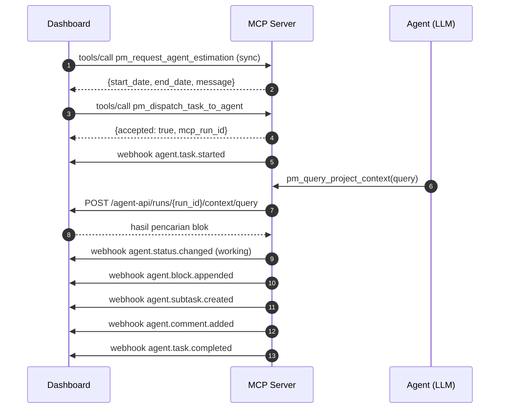
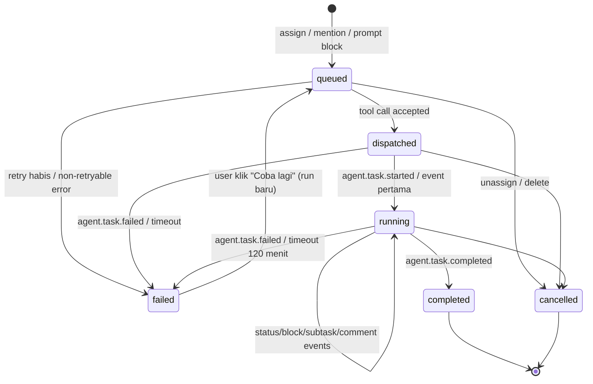

# MCP Integration Guide
## Modul 1: Project Management

Dokumen ini mendefinisikan kontrak komunikasi antara Backend Modul 1 (Dashboard) dengan Custom MCP Server (Project 2). Dokumen ini adalah **kontrak bersama**: perubahan apa pun harus disetujui kedua tim dan menaikkan `contract_version`.

- **Contract version:** `1.0`
- Schema Zod untuk semua payload di bawah ada di `packages/shared/src/mcp/` dan dipakai oleh Dashboard serta Mock MCP ([TASK_009](M1_TASK_009_MOCK_MCP_DEVTOOLS.md)).

---

### 0. Gambaran & Arah Komunikasi

| Arah | Mekanisme | Isi |
|---|---|---|
| Dashboard → MCP Server | **MCP `tools/call`** via Streamable HTTP | Perintah ke agent: dispatch, estimasi, mention, prompt block, cancel |
| MCP Server → Dashboard | **Webhook HTTPS** (HMAC) | Hasil kerja agent: status, blok, subtask, komentar, selesai/gagal |
| MCP Server → Dashboard | **Agent API** (REST, service token) | Membaca task, blok, dan mencari konteks project (dipakai tool `pm_query_project_context`) |



### 1. Identitas & Korelasi

| Field | Pemilik | Keterangan |
|---|---|---|
| `agent_key` | Dashboard (`agents.mcp_agent_key`) | Nama agent di MCP Server, mis. `strategist`. Dashboard dan MCP harus memakai nilai yang sama |
| `agent_id` | Dashboard | UUID agent di Dashboard, dikirim balik di setiap webhook |
| `run_id` | Dashboard (`agent_runs.id`) | **ID korelasi utama.** Dibuat Dashboard untuk setiap sesi kerja; wajib ada di setiap webhook & panggilan Agent API |
| `mcp_run_id` | MCP Server | ID internal MCP, dikembalikan saat dispatch, disimpan untuk debugging |
| `event_id` | MCP Server | UUID unik per webhook (idempotency) |

### 2. Transport & Autentikasi

**Dashboard → MCP Server**
- Endpoint: `MCP_SERVER_URL` (mis. `https://mcp.internal/mcp`), protokol MCP **Streamable HTTP**.
- Header: `Authorization: Bearer <MCP_SERVER_API_KEY>`.
- Dashboard memakai `@modelcontextprotocol/sdk` `Client` + `StreamableHTTPClientTransport`, memanggil `tools/call` dengan `arguments` sesuai schema di §3.
- Hasil tool **wajib** berisi `structuredContent` (objek JSON sesuai output schema). Jika gagal, kembalikan `isError: true` dengan `structuredContent: { "code": "...", "message": "...", "retryable": true|false }`.
- Timeout: `MCP_CALL_TIMEOUT_MS` (15 s) untuk tool async, `MCP_ESTIMATION_TIMEOUT_MS` (30 s) untuk estimasi.
- Semua tool menerima field `contract_version: "1.0"`. MCP Server menolak versi major yang tidak dikenal dengan `code: "UNSUPPORTED_CONTRACT_VERSION"`, `retryable: false`.

**MCP Server → Dashboard (webhook)**
- `POST {PUBLIC_API_URL}/api/v1/webhooks/mcp/events` (URL lengkap juga dikirim di field `callback.webhook_url` saat dispatch).
- Header wajib:
  - `Content-Type: application/json`
  - `X-MCP-Timestamp: <unix seconds>`
  - `X-MCP-Signature: sha256=<hex>` dengan `hex = HMAC_SHA256(MCP_WEBHOOK_SECRET, "<X-MCP-Timestamp>.<raw_body>")`
- Dashboard menolak jika selisih timestamp > 300 detik (anti-replay) atau signature salah → 401 `INVALID_SIGNATURE`.

**MCP Server → Dashboard (Agent API)**
- Header: `Authorization: Bearer <MCP_SERVICE_TOKEN>`.
- Akses di-scope ke `run_id` di path: hanya data dalam **project** milik run tersebut, dan hanya selama run aktif.

### 3. MCP Tools (Dashboard → MCP Server)
Tools yang dipanggil oleh Dashboard ketika user berinteraksi dengan Agent di Modul 1. Semua dipanggil dari worker queue (bukan dari request HTTP user).

Tipe bersama yang dipakai di input:
```jsonc
// TaskSnapshot
{
  "id": "uuid", "project_id": "uuid", "workspace_id": "uuid",
  "parent_task_id": "uuid|null", "depth": 1,
  "title": "Generate Content Calendar",
  "status": "todo", "priority": "medium",
  "start_date": "2026-11-01|null", "end_date": "2026-11-02|null",
  "is_milestone": false, "tags": ["content"],
  "url": "https://app.domain.com/w/<ws>/p/<project>/t/<task>"
}
// ContextBlock (maks 200 blok / 100 KB, urut sesuai dokumen)
{
  "id": "uuid", "parent_block_id": "uuid|null", "block_type": "paragraph",
  "content_json": { /* lihat TASK_003 §Block format */ },
  "plain_text": "Brief: buat kalender konten 3 minggu...",
  "version": 3
}
```

#### 3.1 `pm_dispatch_task_to_agent`
* **Trigger:** User assign task ke Agent (setelah estimasi bila diperlukan).
* **Mode:** async — MCP harus membalas segera setelah menerima pekerjaan (≤ 15 s), pekerjaan dilakukan di background.
* **Input:**
```json
{
  "contract_version": "1.0",
  "run_id": "uuid",
  "agent_key": "strategist",
  "agent_id": "uuid",
  "task": { "...": "TaskSnapshot" },
  "task_description": "plain text gabungan seluruh blok task",
  "context_blocks": [ { "...": "ContextBlock" } ],
  "subtasks": [ { "id": "uuid", "title": "...", "status": "todo", "depth": 2 } ],
  "dispatched_by": { "user_id": "uuid", "display_name": "Owner Demo" },
  "callback": {
    "webhook_url": "https://api.domain.com/api/v1/webhooks/mcp/events",
    "agent_api_base_url": "https://api.domain.com/api/v1/agent-api"
  },
  "limits": { "max_depth": 3, "max_subtasks_per_event": 20, "max_blocks_per_event": 50 }
}
```
* **Output (`structuredContent`):** `{ "accepted": true, "mcp_run_id": "string" }`
* **Action:** MCP Server memicu Agent untuk mulai mengerjakan task dan mengirim webhook sesuai §5.
* **Efek di Dashboard:** run `queued → dispatched`, simpan `mcp_run_id`. `accepted: false` atau error non-retryable → run `failed`.

#### 3.2 `pm_request_agent_estimation`
* **Trigger:** User assign task ke Agent **dan** task belum punya `start_date` maupun `end_date`.
* **Mode:** sync, timeout 30 s.
* **Input:**
```json
{
  "contract_version": "1.0",
  "run_id": "uuid",
  "agent_key": "strategist",
  "task": { "...": "TaskSnapshot" },
  "task_description": "string",
  "context_blocks": [],
  "earliest_start_date": "2026-10-29",
  "timezone": "Asia/Jakarta"
}
```
* **Output:**
```json
{
  "start_date": "2026-10-29",
  "end_date": "2026-10-30",
  "estimated_days": 2,
  "confidence": 0.7,
  "message": "Saya akan mengerjakan ini. Estimasi selesai 2 hari."
}
```
* **Action:** Agent menganalisis deskripsi dan mengembalikan estimasi `start_date` dan `end_date`.
* **Efek di Dashboard:** validasi (`end_date ≥ start_date`, `start_date ≥ earliest_start_date`); isi tanggal **hanya jika masih kosong**; jika ada `message`, simpan sebagai komentar dengan author agent; catat activity `agent.estimated`. Gagal/timeout → lanjut dispatch tanpa tanggal (activity `agent.estimation_failed`).

#### 3.3 `pm_notify_agent_mention` *(baru)*
* **Trigger:** Komentar baru me-mention agent aktif (oleh manusia). Mention di dalam blok editor **tidak** memicu agent.
* **Mode:** async.
* **Input:**
```json
{
  "contract_version": "1.0",
  "run_id": "uuid",
  "agent_key": "strategist",
  "agent_id": "uuid",
  "task": { "...": "TaskSnapshot (null jika komentar di level project)" },
  "project_id": "uuid",
  "comment": {
    "id": "uuid", "parent_comment_id": "uuid|null",
    "content": "@Agent_Strategist Tolong ubah tone di Week 2 menjadi lebih formal.",
    "author": { "type": "user", "id": "uuid", "display_name": "Manager Demo" },
    "created_at": "2026-11-02T03:00:00Z"
  },
  "thread": [ { "id": "uuid", "content": "...", "author": { "type": "agent", "id": "uuid", "display_name": "Agent_Strategist" } } ],
  "context_blocks": [],
  "callback": { "webhook_url": "...", "agent_api_base_url": "..." }
}
```
* **Output:** `{ "accepted": true, "mcp_run_id": "string" }`

#### 3.4 `pm_execute_prompt_block` *(baru, P1 — feature flag)*
* **Trigger:** User klik "Jalankan" pada AI Prompt Block.
* **Input:** `{ contract_version, run_id, agent_key, agent_id, task (TaskSnapshot|null), project_id, prompt_block: { id, prompt, version }, context_blocks, callback }`
* **Output:** `{ "accepted": true, "mcp_run_id": "string" }`
* Agent menulis hasil via `agent.block.appended` dengan `after_block_id = prompt_block.id`.

#### 3.5 `pm_cancel_agent_run` *(baru)*
* **Trigger:** Task di-unassign/di-reassign dari agent, task/project dihapus, atau agent dinonaktifkan saat run aktif.
* **Input:** `{ "contract_version": "1.0", "run_id": "uuid", "mcp_run_id": "string|null", "reason": "unassigned|task_deleted|agent_deactivated|user_cancelled" }`
* **Output:** `{ "cancelled": true }` — MCP harus menghentikan agent dan **tidak** mengirim webhook lagi untuk run ini. Dashboard menandai run `cancelled` sebelum memanggil tool ini, sehingga webhook yang terlambat akan ditolak `409 RUN_NOT_ACTIVE`.

#### 3.6 `pm_query_project_context` *(tool milik MCP Server untuk Agent)*
* **Trigger:** Agent membutuhkan konteks lebih dalam tentang proyek saat mengerjakan task.
* **Siapa memanggil:** **Agent (LLM) di dalam MCP Server** — bukan Dashboard. MCP Server mengimplementasikan tool ini dengan memanggil Agent API Dashboard (§6).
* **Input dari agent:** `{ "query": "brief utama kampanye Q4", "scope": "project" | "task", "top_k": 8 }`
* **Action:** MCP memanggil `POST /agent-api/runs/{run_id}/context/query`, (opsional) melakukan re-ranking/RAG tambahan, lalu mengembalikan konteks ke Agent.
* Dashboard M1 menyediakan pencarian **PostgreSQL full-text search** atas `document_blocks.plain_text`. Bila query kosong, dikembalikan blok Project Brief (dokumen level project) secara berurutan.

### 4. Siklus Hidup Agent Run



Pemetaan ke `tasks.agent_status` (untuk badge UI): `queued`→`queued`, `dispatched`→`queued`, `running`→`thinking`/`working` (mengikuti `agent.status.changed`, default `working`), `completed`→`completed`, `failed`→`failed`, `cancelled`→`idle`.
Untuk run bertrigger `mention`/`prompt_block`, status task **tidak** diubah ke `in_progress`/`done`; hanya `agent_status`.

### 5. MCP Events / Webhooks (MCP Server → Dashboard)
Event asinkron yang dikirimkan MCP Server ke Backend Dashboard saat Agent bekerja.

**Envelope (semua event):**
```json
{
  "contract_version": "1.0",
  "event_id": "8a3c6a3e-1b1f-4c3e-9b1e-6d2f0c1b9a11",
  "event_type": "agent.block.appended",
  "occurred_at": "2026-11-01T03:15:00Z",
  "run_id": "uuid",
  "agent_id": "uuid",
  "task_id": "uuid",
  "data": { }
}
```
`task_id` harus task milik run **atau** turunannya (subtask yang dibuat di run tersebut / sudah ada di bawahnya), kecuali untuk run komentar level project (`task_id: null`, hanya event komentar & blok brief yang diizinkan).

| Event | `data` | Efek di Dashboard |
|---|---|---|
| `agent.task.started` | `{}` | Run `running`; untuk trigger `assignment`: task `status = in_progress` (jika masih `todo`); `agent_status = working`; activity `agent.started` |
| `agent.status.changed` | `{ "status": "thinking" \| "working", "message": "Membaca brief project..." }` | `agent_status` diubah; event real-time `agent.status` (tidak dicatat di activity) |
| `agent.block.appended` | lihat di bawah | Upsert blok dengan aktor agent; activity `block.agent_updated` ("Agent updated this block") per event berisi daftar `block_ids` |
| `agent.subtask.created` | lihat di bawah | Buat subtask (aktor agent), activity `task.created` per subtask |
| `agent.comment.added` | `{ "content": "string ≤ 10.000", "parent_comment_id": "uuid\|null", "mentions": [ { "type": "user", "id": "uuid" } ] }` | Simpan komentar author agent; notifikasi `agent_comment` ke pembuat task & user yang memicu run; mention user → `comment_mention` |
| `agent.task.completed` | `{ "summary": "string\|null" }` | Run `completed`; trigger `assignment`: task `status = done`, `completed_at`; `agent_status = completed`; notifikasi `agent_task_completed` ke user yang dispatch & pembuat task |
| `agent.task.failed` | `{ "error_code": "LLM_TIMEOUT", "message": "string", "retryable": true }` | Run `failed`; `agent_status = failed`; status task **tidak** diubah; notifikasi `agent_task_failed`; komentar sistem berisi pesan error |

**`agent.block.appended` → `data`:**
```json
{
  "operations": [
    {
      "op": "append",
      "block": {
        "id": "uuid (opsional, dibuat Dashboard jika kosong)",
        "parent_block_id": null,
        "block_type": "heading",
        "content_json": { "props": { "level": 2 }, "content": [ { "type": "text", "text": "Week 1", "styles": {} } ] }
      },
      "after_block_id": "uuid|null (null = di akhir dokumen)"
    },
    {
      "op": "update",
      "block": { "id": "uuid", "block_type": "paragraph", "content_json": { "props": {}, "content": [] } },
      "expected_version": 4
    }
  ]
}
```
- Maks 50 operasi per event. `content_json` divalidasi dengan schema blok yang sama dengan editor (TASK_003); blok invalid → seluruh event ditolak 400 `VALIDATION_ERROR` dengan indeks operasi.
- `update` dengan `expected_version` yang tidak cocok tidak diterapkan dan dilaporkan di respons (`conflicts`). Tanpa `expected_version` → last-write-wins.
- Agent tidak dapat menghapus blok di M1.

**`agent.subtask.created` → `data`:**
```json
{
  "parent_task_id": "uuid (default: task_id envelope)",
  "subtasks": [
    {
      "client_ref": "week-1",
      "title": "Draft Week 1",
      "priority": "medium",
      "start_date": "2026-11-01",
      "end_date": "2026-11-01",
      "tags": ["content"],
      "assign_to_self": true,
      "initial_blocks": [ { "block_type": "paragraph", "content_json": { "props": {}, "content": [ { "type": "text", "text": "...", "styles": {} } ] } } ]
    }
  ]
}
```
- Maks 20 subtask per event, kedalaman hasil ≤ 3 (jika tidak → 422 `HIERARCHY_DEPTH_EXCEEDED`, tidak ada yang dibuat).
- `assign_to_self: true` → assignee = agent ini, **tanpa** dispatch baru (agent mengelola subtask dalam run yang sama).
- Respons memetakan `client_ref` ke ID baru agar agent bisa menulis blok ke subtask tersebut.

**Respons webhook:**

| HTTP | Body | Arti untuk MCP |
|---|---|---|
| 200 | `{ "status": "processed", "result": { ... } }` | Berhasil. `result` untuk block: `{ "applied": [{ "id", "version" }], "conflicts": [{ "id", "server_version" }] }`; untuk subtask: `{ "created": [{ "client_ref", "id" }] }`; untuk komentar: `{ "comment_id" }` |
| 200 | `{ "status": "duplicate" }` | `event_id` sudah pernah diproses — jangan kirim ulang |
| 400 | error `VALIDATION_ERROR` | Payload salah — **jangan retry** tanpa perbaikan |
| 401 | `INVALID_SIGNATURE` | Cek secret/jam server — jangan retry otomatis |
| 404 | `NOT_FOUND` | Task/run tidak ditemukan — jangan retry |
| 409 | `RUN_NOT_ACTIVE` | Run sudah selesai/dibatalkan — **hentikan agent** |
| 422 | aturan bisnis | Perbaiki payload — jangan retry |
| 429 / 5xx | — | **Retry** dengan backoff eksponensial (1s, 2s, 4s … maks 5 menit, total ≤ 30 menit) dengan `event_id` yang **sama** |

### 6. Agent API (MCP Server → Dashboard)
Semua endpoint: `Authorization: Bearer <MCP_SERVICE_TOKEN>`; run harus aktif (`queued|dispatched|running`), jika tidak → 409 `RUN_NOT_ACTIVE`. Rate limit 300 req/menit per run.

| Endpoint | Fungsi |
|---|---|
| `GET /api/v1/agent-api/runs/{run_id}` | Detail run: trigger, agent, task, `dispatched_by`, komentar pemicu (untuk mention) |
| `GET /api/v1/agent-api/runs/{run_id}/tasks/{task_id}` | TaskSnapshot + blok (tree) + subtask + 50 komentar terakhir. `task_id` harus dalam project run |
| `GET /api/v1/agent-api/runs/{run_id}/project-brief` | Seluruh blok Project Brief |
| `POST /api/v1/agent-api/runs/{run_id}/context/query` | Full-text search (lihat di bawah) |

`POST .../context/query`
```json
// request
{ "query": "tone of voice brand", "scope": "project", "task_id": null, "top_k": 8 }
// response
{
  "results": [
    {
      "block_id": "uuid", "task_id": "uuid|null", "task_title": "string|null",
      "source": "project_brief|task",
      "block_type": "paragraph",
      "text": "Tone of voice: profesional namun hangat...",
      "rank": 0.42
    }
  ]
}
```
`top_k` maks 20; teks per hasil dipotong 2.000 karakter. Query memakai `websearch_to_tsquery('simple', query)` + `ts_rank`.

### 7. Keandalan & Aturan Main

| Aturan | Detail |
|---|---|
| Idempotency | Dashboard menyimpan `event_id` di `mcp_webhook_events`; event berulang tidak diproses dua kali |
| Urutan event | MCP **wajib** mengirim webhook satu per satu per run (tunggu respons sebelum event berikutnya). Event pertama apa pun selain `started` otomatis membuat run `running` |
| Retry Dashboard → MCP | Job BullMQ 5x backoff eksponensial; error `retryable: false` → langsung `failed` |
| Timeout run | Tidak ada webhook selama `AGENT_RUN_TIMEOUT_MINUTES` (120) → run `failed`, `error_code: RUN_TIMEOUT` |
| Pencegahan loop | Komentar/blok dari agent **tidak** memicu agent lain; subtask `assign_to_self` tidak memicu dispatch baru; maks 1 run `assignment` aktif per task; maks 10 run `mention` per task per jam |
| Batas ukuran | Body webhook ≤ 1 MB; `content_json` per blok ≤ 64 KB; komentar ≤ 10.000 karakter |
| Retry manual | User dapat klik "Coba lagi" pada run `failed` → run **baru** dengan `run_id` baru |

### 8. Keamanan
- Ketiga secret (`MCP_SERVER_API_KEY`, `MCP_WEBHOOK_SECRET`, `MCP_SERVICE_TOKEN`) berbeda, minimal 32 byte acak, dirotasi via env tanpa downtime (Dashboard menerima secret lama & baru selama masa transisi: `MCP_WEBHOOK_SECRET_PREVIOUS`).
- Komunikasi produksi wajib HTTPS (atau jaringan privat).
- Data yang dikirim ke MCP hanya data project terkait; email user **tidak** dikirim (hanya `display_name` dan ID).
- Agent tidak dapat: mengubah assignee, menghapus task/blok, mengubah member, atau mengakses project lain.
- Konten dari agent diperlakukan sama dengan input user: divalidasi schema, dirender sebagai teks (tidak pernah sebagai HTML mentah).

### 9. Checklist untuk Tim Project 2 (MCP Server)
- [ ] Endpoint MCP Streamable HTTP dengan auth Bearer.
- [ ] Implementasi tool §3.1–3.5 sesuai input/output schema (gunakan `packages/shared/src/mcp` sebagai acuan).
- [ ] Tool agent `pm_query_project_context` yang memanggil Agent API §6.
- [ ] Pengirim webhook dengan HMAC, `event_id` unik, retry sesuai tabel §5, pengiriman berurutan per run.
- [ ] Menghentikan agent saat `pm_cancel_agent_run` atau respons `409 RUN_NOT_ACTIVE`.
- [ ] Pemetaan `agent_key` ↔ agent internal.
- [ ] Lulus *contract test* (suite di `apps/api/test/contract/`) terhadap staging Dashboard.

### 10. Pengujian
- Lokal & CI memakai **Mock MCP Server** ([TASK_009](M1_TASK_009_MOCK_MCP_DEVTOOLS.md)) yang mengimplementasikan kontrak ini.
- Contract test memastikan Mock MCP dan MCP Server Project 2 menghasilkan payload yang lolos schema `packages/shared`.
