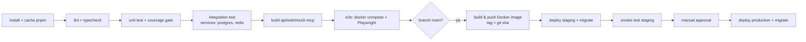

# Task: Quality Assurance, Testing & Deployment
**ID:** M1_TASK_008
**Status:** To Do
**Dependencies:** All M1 Tasks (setup CI & environment staging dimulai sejak Sprint 0)
**Estimasi:** 8 person-days (QA + DevOps)

## Objective
Memastikan Modul 1 stabil, aman, dan siap digunakan sebelum Modul 2 dikerjakan.

## A. Strategi Test

| Level | Tools | Lingkup | Target |
|---|---|---|---|
| Unit backend | Jest/Vitest | Service & validator (lihat bagian Testing di TASK_001–003) | Coverage ≥ 80% lines & branches untuk `apps/api/src` dan `packages/shared` |
| Unit frontend | Vitest + Testing Library | `lib/`, hooks, adapter/diff editor, reducer realtime, komponen kunci | Coverage ≥ 70% untuk `lib/`, `features/**/hooks`, `features/editor/*.ts` |
| Integration API | Supertest + Testcontainers (Postgres 17, Redis 7) + Mock MCP | Endpoint nyata ke DB nyata | Semua endpoint punya minimal 1 happy path + 1 error path |
| Contract | Schema `packages/shared/src/mcp` | Payload Mock MCP & MCP Server Project 2 | 100% tool & event lolos schema |
| E2E | Playwright (Chromium + Firefox + WebKit) | Skenario UC di stack docker compose + Mock MCP | Semua skenario E2E lulus |
| Security | Suite IDOR/XSS otomatis + OWASP ZAP baseline + audit dependency | Lihat §C | 0 temuan Critical/High |
| Performance | k6 + Chrome Performance | Lihat §D | Threshold terpenuhi |

## B. Testing
- [ ] **Unit Testing:** Test business logic di backend (terutama validasi tanggal, hierarki subtask, reschedule cascade, RBAC, signature webhook, schema blok, batch & konflik versi).
- [ ] **Integration Testing:** Test alur penuh dari Frontend -> Backend -> MCP Webhook -> DB.
- [ ] **E2E scenarios** (`e2e/`), data dari seed, MCP = Mock MCP (skenario dipilih via `agent_key`, lihat TASK_009):

| ID | Skenario | UC |
|---|---|---|
| E2E-01 | Buat project, task, set tanggal, 2 subtask, drag subtask di Timeline, cek konsisten di List & Board | UC1 |
| E2E-02 | Buat task, tulis brief, assign `@Agent_Strategist` → tanggal terisi + komentar estimasi | UC2 |
| E2E-03 | Lanjutan E2E-02: badge Working → blok agent muncul → 3 subtask → status Done + toast (di browser kedua juga) | UC3 |
| E2E-04 | Manager komentar mention agent → blok terupdate & balasan agent | UC4 |
| E2E-05 | Reschedule parent dengan dialog cascade (shift & none) | UC5 |
| E2E-06 | Board drag dengan mouse & keyboard | UC6 |
| E2E-07 | Admin tambah member Viewer; Viewer read-only; outsider 404 | UC7 |
| E2E-08 | Notifikasi: unread count, klik, tandai semua dibaca | UC8 |
| E2E-09 | AI Prompt Block (hanya jika flag aktif) | UC9 |
| E2E-10 | Agent gagal (`agent_key: failing`) → badge Gagal → Coba lagi | UC3 alt |
| E2E-11 | MCP mati → retry → Gagal; nyalakan → Coba lagi berhasil | UC2 alt |
| E2E-12 | Auto-save: ketik, reload, konten sama; offline → "Gagal menyimpan" → online → tersimpan | FR-11 |

- [ ] **Security Testing:**
    - Test XSS pada Block Editor (coba inject ``, ``, `javascript:alert(1)` sebagai link/image/bookmark URL, `data:text/html,...`, properti `onClick` di `content_json`, payload di judul task, komentar, nama agent, dan dari webhook agent. Ekspektasi: ditolak atau tampil sebagai teks, tidak ada eksekusi script (cek via Playwright `page.on('dialog')`).
    - Test IDOR (Insecure Direct Object Reference) - pastikan User A tidak bisa akses Project User B: suite otomatis yang menjalankan **setiap endpoint** (GET/POST/PATCH/DELETE, termasuk blocks, comments, activity, timeline, agent-run, room Socket.IO) dengan token `outsider@demo.local` terhadap resource "Matrika Demo" → wajib 404; dengan token Viewer untuk aksi tulis → wajib 403.
    - Auth: token tanpa signature/`alg: none`, token expired, refresh token reuse, brute force login (rate limit), cookie flags (`HttpOnly`, `Secure`, `SameSite`).
    - Webhook & Agent API: signature salah, timestamp kedaluwarsa (replay), `event_id` duplikat, run milik project lain, run dibatalkan, service token salah.
    - OWASP ZAP baseline scan ke staging; `pnpm audit --prod` & Trivy scan image Docker (0 Critical/High yang bisa diperbaiki).
    - Cek header keamanan (CSP, HSTS, X-Content-Type-Options, frame-ancestors).
- [ ] **Performance Testing:** Load test pada endpoint Block Editor dan Timeline dengan 1000+ blocks/tasks.
    - Data: `pnpm --filter api db:seed:large` → 1 project berisi 1000 task (3 level) dan 1 task berisi 1000 blok.
    - k6 (`load-tests/`), 50 virtual user, 5 menit, di staging:

| Endpoint | Threshold |
|---|---|
| `GET /tasks/:id/blocks` (1000 blok) | p95 < 200 ms |
| `POST /blocks/batch` (50 operasi) | p95 < 200 ms |
| `GET /projects/:id/timeline` (1000 task) | p95 < 500 ms |
| `GET /projects/:id/tasks?view=list` | p95 < 500 ms |
| `PATCH /tasks/:id` | p95 < 200 ms |
| Semua | error rate < 1% |

    - Frontend: Timeline & List dengan 1000 task — scroll tanpa frame drop berarti, drag bar < 100 ms; editor 1000 blok — tidak ada long task > 50 ms saat mengetik.
    - Real-time: 100 koneksi socket di 1 project, latency event < 2 detik.

## C. CI/CD Pipeline
- [ ] Setup CI/CD Pipeline (**GitHub Actions**; GitLab CI setara):

- Pull request: langkah A–F wajib hijau sebelum merge; laporan coverage & artefak Playwright (trace, video) disimpan.
- Migrasi DB dijalankan sebagai langkah rilis terpisah (`prisma migrate deploy`) **sebelum** container baru menerima trafik; migrasi harus backward-compatible dengan versi app sebelumnya (expand → migrate → contract).
- Secret disimpan di GitHub Environments (staging, production) dengan reviewer wajib untuk production.

## D. Deployment
- [ ] Konfigurasi Environment Variables (DB, JWT Secret, MCP URL & secrets, Sentry, dll.) — daftar lengkap [ARCHITECTURE §9](M1_ARCHITECTURE.md#9-environment-variables). Nilai produksi dibuat baru (bukan dari `.env.example`), disimpan di secret manager.
- [ ] Deploy Backend API ke server/cloud (Dockerized):
  - Image multi-stage, Node 24 slim, user non-root, `HEALTHCHECK` ke `/health`, `NODE_ENV=production`.
  - Default (README D4): VM (mis. AWS EC2) + Docker Compose + reverse proxy **Caddy/Nginx** (TLS otomatis, WebSocket upgrade, body limit 1 MB); PostgreSQL managed (mis. RDS) dengan backup otomatis; Redis (managed atau container dengan persistence).
  - Jika > 1 instance API: Socket.IO Redis adapter + sticky session di load balancer.
  - Swagger dinonaktifkan atau dilindungi di produksi; seed tidak pernah dijalankan di produksi.
- [ ] Deploy Frontend ke **Cloudflare Pages** (atau Vercel/Netlify): build `apps/web`, SPA fallback ke `index.html`, header CSP & keamanan, domain satu site dengan API (mis. `app.domain.com` & `api.domain.com`) agar cookie refresh berfungsi (ARCHITECTURE §5).
- [ ] Mock MCP **tidak** di-deploy ke produksi (hanya lokal, CI, dan opsional staging dengan flag).
- [ ] Setup Monitoring & Logging:
  - **Sentry** untuk error tracking (API + web, dengan release = git sha & source maps).
  - Log JSON (pino) dikirim ke **Datadog/ELK/Loki**; field wajib `request_id`, `user_id`, `workspace_id`, `run_id`.
  - Uptime check `/health` tiap 1 menit.
  - Alert: error rate 5xx > 2% (5 menit), p95 latency di atas threshold §B, job `mcp-outbound` gagal > 10/jam, webhook ditolak (401) > 20/jam, disk DB > 80%.
- [ ] Backup & restore: backup DB harian (retensi 14 hari) + **uji restore** sekali sebelum go-live.
- [ ] Rollback plan: deploy ulang image versi sebelumnya (tag git sha); migrasi bersifat expand-only sehingga aman untuk rollback app.

## E. Go-Live Checklist
- [ ] Semua E2E lulus di staging dengan MCP Server Project 2 (atau Mock MCP jika Project 2 belum siap — catat sebagai risiko).
- [ ] Contract test MCP Server Project 2 lulus.
- [ ] UAT oleh stakeholder memakai skenario UC1–UC4 (catat hasil di tabel di bawah).
- [ ] Secret produksi unik & tersimpan di secret manager; tidak ada secret di repo (cek dengan gitleaks).
- [ ] Monitoring, alert, backup aktif.
- [ ] Akun awal produksi dibuat (Owner workspace) dan agent produksi didaftarkan dengan `mcp_agent_key` yang benar.

| Tanggal UAT | Use case | Penguji | Hasil | Catatan |
|---|---|---|---|---|
| | | | | |

## Acceptance Criteria
- Semua test cases pass; coverage backend ≥ 80% (frontend sesuai target §A).
- Tidak ada vulnerability kritis (XSS, IDOR) maupun temuan Critical/High dari ZAP, `pnpm audit`, dan Trivy.
- Threshold performa §B terpenuhi di staging.
- Pipeline CI/CD berjalan otomatis dari PR hingga staging, dan ke production dengan approval.
- Modul 1 dapat diakses secara publik/internal via HTTPS dan stabil digunakan untuk simulasi proyek (UAT UC1–UC4 lulus).
