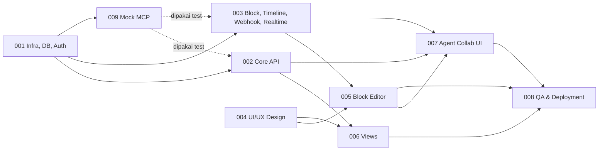

# Modul 1 — Agentic Project Management
## Index Dokumen, Urutan Kerja & Keputusan Teknis

> Dokumen ini adalah **pintu masuk** Modul 1. Baca ini dulu sebelum membuka dokumen task.
> Versi dokumen: **1.1** (melengkapi versi awal 1.0). Semua perubahan dari versi awal tercatat di [§7 Changelog](#7-changelog-dari-versi-awal-dokumen).

---

### 1. Ringkasan Modul
Modul 1 membangun ruang kerja proyek ala Notion (block editor + hierarki Workspace → Project → Task → Subtask) yang digabung dengan Timeline/Gantt, di mana **AI Agent bisa di-assign sebagai anggota tim**. Agent berjalan di **Custom MCP Server (Project 2)**; Dashboard (Modul 1) berkomunikasi dengannya lewat MCP tools (Dashboard → MCP) dan webhook (MCP → Dashboard).

Agar Modul 1 **bisa dijalankan dan dites end-to-end tanpa menunggu Project 2**, disediakan **Mock MCP Server** ([M1_TASK_009](M1_TASK_009_MOCK_MCP_DEVTOOLS.md)) yang mengimplementasikan kontrak yang sama.

### 2. Peta Dokumen

| Dokumen | Isi | Pembaca utama |
|---|---|---|
| [M1_PRD.md](M1_PRD.md) | Visi, scope, requirement fungsional (FR) & non-fungsional (NFR), glosarium | Semua |
| [M1_USE_CASES.md](M1_USE_CASES.md) | Use case detail (alur utama, alternatif, error) + traceability ke task | PM, QA, Dev |
| [M1_ARCHITECTURE.md](M1_ARCHITECTURE.md) | Tech stack, struktur repo, konvensi API, real-time, env vars, **cara menjalankan lokal** | Dev, DevOps |
| [M1_MCP_INTEGRATION.md](M1_MCP_INTEGRATION.md) | Kontrak lengkap Dashboard ↔ MCP Server (tools, webhook, Agent API, keamanan) | Dev Modul 1 & tim Project 2 |
| [M1_TASK_001](M1_TASK_001_INFRA_SECURITY_DB.md) | Database schema (DDL), Auth JWT, RBAC, rate limit, sanitasi | Backend |
| [M1_TASK_002](M1_TASK_002_BACKEND_CORE_API.md) | API Workspace, Member, Agent, Project, Task, Comment, Activity, Notification + dispatch ke Agent | Backend |
| [M1_TASK_003](M1_TASK_003_BACKEND_BLOCK_TIMELINE_API.md) | API Block Editor, Timeline, Reschedule, Webhook MCP, Agent API, Real-time Gateway | Backend |
| [M1_TASK_004](M1_TASK_004_UIUX_MOCKUP_DESIGN.md) | Design system & mockup semua layar | UI/UX |
| [M1_TASK_005](M1_TASK_005_FRONTEND_BLOCK_EDITOR.md) | Block editor (BlockNote), slash command, mention, auto-save | Frontend |
| [M1_TASK_006](M1_TASK_006_FRONTEND_VIEWS_TIMELINE.md) | List, Board, Timeline view | Frontend |
| [M1_TASK_007](M1_TASK_007_FRONTEND_AGENT_COLLAB.md) | Assignee picker, status agent, real-time, komentar, activity, notifikasi | Frontend |
| [M1_TASK_008](M1_TASK_008_QA_DEPLOYMENT.md) | Strategi test, CI/CD, deployment, monitoring, go-live checklist | QA, DevOps |
| [M1_TASK_009](M1_TASK_009_MOCK_MCP_DEVTOOLS.md) | Mock MCP Server + CLI pengirim webhook untuk dev & E2E | Backend |

### 3. Urutan Pengerjaan & Dependensi

### 4. Rencana Sprint (estimasi kasar)
Asumsi tim: 2 Backend, 2 Frontend, 1 UI/UX, 1 QA (paruh waktu mulai Sprint 2). Estimasi dalam *person-days* (pd) dan perlu divalidasi tim.

| Sprint | Minggu | Task | Estimasi |
|---|---|---|---|
| Sprint 0 | 1 | Setup monorepo, CI dasar, **001**, mulai **004**, spike versi TS/NestJS & library Gantt | 001: 5 pd, spike: 2 pd |
| Sprint 1 | 2–3 | **002**, **003**, **009**, selesaikan **004** | 002: 8 pd, 003: 8 pd, 009: 3 pd, 004: 8 pd |
| Sprint 2 | 4–5 | **005**, **006** | 005: 8 pd, 006: 10 pd |
| Sprint 3 | 6 | **007**, mulai test E2E | 007: 6 pd |
| Sprint 4 | 7 | **008** (hardening, security, performance, deployment, UAT) | 008: 8 pd |

### 5. Definition of Done (berlaku untuk semua task)
1. Semua checklist di dokumen task tercentang dan **Acceptance Criteria** terpenuhi.
2. Kode lolos `lint`, `typecheck`, unit test & integration test di CI.
3. Endpoint baru terdokumentasi otomatis di Swagger (`/api/docs`) dan sesuai kontrak di dokumen ini.
4. Migrasi database bisa dijalankan dari nol (`migrate deploy`) dan seed berjalan.
5. Fitur bisa didemokan di environment lokal (`docker compose` + Mock MCP) mengikuti use case terkait.
6. Tidak ada secret di repository; env var baru ditambahkan ke `.env.example` dan [M1_ARCHITECTURE.md §9](M1_ARCHITECTURE.md#9-environment-variables).
7. Code review disetujui minimal 1 reviewer.

### 6. Keputusan Teknis yang Perlu Dikonfirmasi
Kolom "Default" adalah keputusan yang dipakai di semua dokumen sampai ada konfirmasi lain.

| # | Topik | Default yang dipakai di dokumen | Alternatif |
|---|---|---|---|
| D1 | Versi TypeScript 7 & NestJS 12 (dari PRD) | Pin versi stable terbaru **setelah spike** di Sprint 0 membuktikan decorator NestJS (`experimentalDecorators`, `emitDecoratorMetadata`), Prisma & Vite berjalan. Jika tidak kompatibel, pakai TS major sebelumnya yang didukung NestJS | — |
| D2 | Library Gantt | Spike 1 hari **SVAR React Gantt** (edisi open source; lisensi wajib dicek). Jika tidak memenuhi, **custom Gantt** (React + TanStack Virtual) | DHTMLX / Bryntum (berbayar) |
| D3 | Status task | 4 status: `todo`, `in_progress`, `in_review`, `done` | Hanya 3 status (tanpa `in_review`) |
| D4 | Hosting | Backend: Docker di VM (mis. AWS EC2) + PostgreSQL managed + Redis; Frontend: Cloudflare Pages | Full container platform (ECS/Kubernetes) |
| D5 | Hak akses Viewer | Hanya baca (tidak bisa komentar) | Viewer boleh komentar |
| D6 | Registrasi Agent | Didaftarkan manual oleh Admin (+ seed), dipetakan ke `mcp_agent_key` di MCP Server | Sinkron otomatis dari MCP Server |
| D7 | Permission level project | Semua member workspace bisa melihat semua project di workspace tersebut | Permission per project |
| D8 | Frontend framework | **Vite + React SPA** (bukan Next.js) karena dashboard internal di balik login, tanpa kebutuhan SEO/SSR | Next.js |
| D9 | AI Prompt Block | Termasuk M1 dengan prioritas **P1** (di balik feature flag `FEATURE_AI_PROMPT_BLOCK`) karena butuh tool tambahan di Project 2 | Dipindah ke Modul berikutnya |

### 7. Changelog dari Versi Awal Dokumen
Perubahan penting yang perlu dicek (alasan ada di dokumen terkait):

**Database ([TASK_001](M1_TASK_001_INFRA_SECURITY_DB.md))**
- `users.permission` dihapus → role disimpan per workspace di tabel baru `workspace_members` (RBAC Owner/Admin/Member/Viewer berlaku per workspace).
- Typo diperbaiki: `update_at` → `updated_at`; `notification.massages` → tabel `notifications` dengan kolom `type`, `title`, `body`, `read_at`, dll.
- Tabel baru: `refresh_tokens`, `workspace_members`, `agents` (direferensikan TASK_002 tapi belum ada), `agent_runs`, `mcp_webhook_events`.
- `tasks` ditambah: `depth`, `assignee_type` + FK terpisah user/agent, `tags` (dari PRD), `order_index`, `agent_status`, `created_by_*`, `completed_at`, `deleted_at` (soft delete).
- `document_blocks` ditambah: `project_id` (wajib, untuk scoping & dokumen brief project), `version` (optimistic locking), `plain_text` + `search_vector` (untuk RAG/full-text search), `deleted_at`.
- `comments` ditambah: `project_id`, `parent_comment_id` (thread), `author_type`, `mentions`.
- `activity_logs` dibuat *append-only* (tanpa `updated_at`), ditambah `entity_type`, `actor_type`, `project_id`.

**API ([TASK_002](M1_TASK_002_BACKEND_CORE_API.md), [TASK_003](M1_TASK_003_BACKEND_BLOCK_TIMELINE_API.md))**
- `/login`, `/register` dipindah ke `/api/v1/auth/*` + endpoint `refresh`, `logout`, `me`.
- Ditambahkan endpoint yang belum ada: workspace, member, agent, list project, get/delete task, move task, comment, activity, notification, get blocks, batch blocks.
- `GET /projects/:id/tasks?view=timeline` digantikan `GET /projects/:id/timeline` (agar tidak dobel); `view` hanya `list|board`.
- Webhook `POST /api/v1/webhooks/mcp-agent-block-update` digantikan **satu endpoint** `POST /api/v1/webhooks/mcp/events` untuk semua event agent (bukan hanya update blok).
- Ditambahkan **Agent API** (`/api/v1/agent-api/*`) agar MCP Server bisa membaca task & konteks project (dibutuhkan `pm_query_project_context`).
- Ditambahkan **Real-time Gateway** (Socket.IO) di backend — sebelumnya hanya disebut di frontend.

**MCP ([M1_MCP_INTEGRATION](M1_MCP_INTEGRATION.md))**
- Arah `pm_query_project_context` diperjelas: tool ini dipanggil **Agent di MCP Server**, yang kemudian membaca data lewat Agent API Dashboard.
- Tool baru: `pm_notify_agent_mention` (dibutuhkan UC4), `pm_cancel_agent_run` (saat task di-unassign/dihapus), `pm_execute_prompt_block` (P1).
- Event baru: `agent.status.changed` (untuk indikator "Thinking/Working"), `agent.task.failed`.
- Ditambahkan payload schema, signature HMAC, idempotency, retry, urutan event, dan pencegahan loop.

**Frontend**
- Next.js → Vite + React SPA (D8).
- Koreksi: **Bryntum Gantt bukan open source** (berbayar, sama seperti DHTMLX Pro). Frappe Gantt tidak mendukung tree grid & virtualisasi untuk 1000 task.
- Ditambahkan Project Brief page (block editor level project) — dibutuhkan UC3 "membaca dokumen brief utama".
- Ditambahkan block yang disebut PRD tapi belum ada di TASK_005: Table, Embed Link (bookmark), AI Prompt Block.

**Dokumen baru**: `README.md` (ini), `M1_ARCHITECTURE.md`, `M1_TASK_009_MOCK_MCP_DEVTOOLS.md`.

### 8. Status Implementasi
| Task | Status | Catatan |
|---|---|---|
| TASK_001 | ✅ Backend selesai | Folder [`backend/`](../../backend/README.md). D1 terverifikasi: TypeScript 7.0.2 + NestJS 12.3 berjalan |
| TASK_002 | ✅ Backend selesai | Termasuk dispatch/estimasi/mention/cancel ke MCP via BullMQ |
| TASK_003 | ✅ Backend selesai | Block API, timeline, webhook MCP, Agent API, Socket.IO |
| TASK_004–007 | Belum dimulai | Frontend |
| TASK_008 | Sebagian | Unit test + smoke test E2E backend; CI/CD & deployment belum |
| TASK_009 | Belum | Hanya CLI `mcp:send-event`; Mock MCP Server belum dibuat |

Perbedaan implementasi terhadap dokumen:
- Struktur repo: backend berdiri sendiri di folder `backend/` dengan **npm** (bukan monorepo pnpm `apps/api`); schema bersama ada di `backend/src/shared/schemas/` dan nanti dipindah ke `packages/shared` saat frontend dibuat.
- RBAC memakai `AccessService` di layer service (bukan decorator `@RequireRole` per route) — hasil 404/403 tetap sesuai TASK_001 §C.2.
- Redis lokal memakai port **6380** (`backend/docker-compose.yml`) karena Redis yang ada di 6379 memakai ACL.
- Lint (ESLint/typescript-eslint) belum dipasang karena belum mendukung TypeScript 7.
