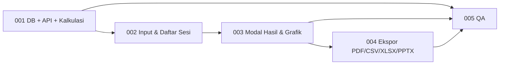

# Modul 2 — Laporan Performa Website (Lead & Sales Report)
## Index Dokumen, Ringkasan Sumber & Keputusan Teknis

> Dokumen ini adalah **pintu masuk** Modul 2. Baca ini dulu sebelum membuka dokumen task.
> Versi dokumen: **1.0** (2 November 2026).

---

### 1. Ringkasan Modul
Modul 2 adalah **kalkulator laporan performa website internal**. User memasukkan data satu periode secara manual (pengunjung, leads/order masuk, sales, nominal omset, biaya maintenance & iklan). Sistem lalu menghitung metrik konversi dan finansial, menampilkannya sebagai kartu KPI dan grafik yang mudah dibaca, dan menyimpan input + hasilnya sebagai **sesi laporan**. Sesi bisa dibuka lagi di modal hasil dan diekspor ke **PDF, CSV, XLSX, dan PPTX**.

Modul ini **tidak** mengambil data otomatis dari Google Analytics/CRM. Semua angka diinput manual (lihat §6 D1).

### 2. Ringkasan Sumber (diskusi Gemini AI Mode, 30 Oktober 2026)
Pertanyaan awal: *"Apabila order masuk melalui website yang di-maintain oleh internal dan mendapatkan lead dan terjadi sales dari sana, bagaimana cara reportnya?"*

Inti jawabannya:
1. **Conversion rate harus dipecah per tahap funnel**, tidak cukup satu angka:
   - **Lead CR** (Website → Lead) = Leads ÷ Pengunjung × 100%
   - **Sales CR** (Website → Sales) = Sales ÷ Pengunjung × 100%
   - **Lead-to-Sales CR** (kualitas lead) = Sales ÷ Leads × 100%. Di bawah ±2% berarti traffic kurang tertarget atau kualitas lead buruk.
2. **Keberhasilan diukur dengan nominal (rupiah), bukan hanya persentase.** Contohnya, Januari punya CR 1% dengan omset Rp50 juta, sedangkan Februari CR-nya hanya 0,5% tetapi omsetnya Rp75 juta. Februari lebih sukses karena nilai per pengunjungnya lebih tinggi. Metrik nominal yang dipakai:
   - **AOV** (Average Order Value) = Omset ÷ Jumlah Sales
   - **RPV/RPC** (Revenue per Visitor) = Omset ÷ Pengunjung. Bandingkan dengan biaya mendatangkan satu pengunjung.
   - **ROAS** = Omset ÷ Biaya (maintenance website + iklan)
3. **Cara melaporkan ke manajemen:**
   - **Laporan efisiensi:** grafik conversion rate (tren minat pengunjung).
   - **Laporan finansial:** grafik total revenue dan RPV (kontribusi uang ke perusahaan), plus perbandingan revenue vs biaya website.
4. **Format laporan** (contoh data aktual dan PPTX tahunan): ringkasan eksekutif finansial (ROAS, AOV, RPV) → tabel metrik funnel beserta interpretasinya → analisis & rencana aksi (naikkan Lead CR lewat UI/UX form, percepat follow-up untuk menaikkan Lead-to-Sales CR).

**Koreksi terhadap sumber** (dipakai di modul ini, detail di [PRD §6](M2_PRD.md#6-spesifikasi-perhitungan)):
- Sumber menulis "ROAS 2465%". Itu sebenarnya ROAS **24,65x** yang dikali 100, **bukan ROI**. ROI pada data yang sama adalah (Omset − Biaya) ÷ Biaya = **2.365%**. Aplikasi menampilkan keduanya secara terpisah dengan label jelas.
- Sumber menulis "Sales CR 0,01%". Itu hasil pembulatan dari ±0,0058%. Aplikasi memakai presisi adaptif agar angka kecil tidak menyesatkan.

### 3. Peta Dokumen

| Dokumen | Isi | Pembaca utama |
|---|---|---|
| [M2_PRD.md](M2_PRD.md) | Visi, scope, FR/NFR, **spesifikasi rumus & aturan interpretasi**, data uji acuan (golden test) | Semua |
| [M2_USE_CASES.md](M2_USE_CASES.md) | Use case detail (alur utama, alternatif, error) + traceability ke task | PM, QA, Dev |
| [M2_TASK_001](M2_TASK_001_DB_BACKEND_API.md) | Tabel `web_report_sessions` (DDL + Prisma), service perhitungan, REST API, RBAC | Backend |
| [M2_TASK_002](M2_TASK_002_FRONTEND_INPUT_SESSIONS.md) | Menu & halaman modul, daftar sesi, form input manual, edit/hapus | Frontend |
| [M2_TASK_003](M2_TASK_003_FRONTEND_RESULT_VISUALIZATION.md) | Modal hasil: kartu KPI, grafik funnel, revenue vs biaya, insight, perbandingan sesi (P1) | Frontend |
| [M2_TASK_004](M2_TASK_004_EXPORT_PDF_CSV_XLSX_PPTX.md) | Ekspor PDF, CSV, XLSX, PPTX | Frontend |
| [M2_TASK_005](M2_TASK_005_QA.md) | Unit/integration/E2E test, golden test perhitungan, checklist rilis | QA |

### 4. Urutan Pengerjaan & Dependensi



| Task | Estimasi |
|---|---|
| 001 | 3 pd |
| 002 | 2 pd |
| 003 | 3 pd (+1 pd perbandingan sesi P1) |
| 004 | 3 pd |
| 005 | 2 pd |

Total ±13–14 person-days. Estimasi ini kasar dan perlu divalidasi tim.

### 5. Definition of Done
Sama dengan [Modul 1 README §5](../modul1/README.md#5-definition-of-done-berlaku-untuk-semua-task), ditambah:
1. Semua **golden test** di [PRD §6.5](M2_PRD.md#65-data-uji-acuan-golden-test) lulus di backend.
2. Keempat format ekspor dibuka dan dicek manual di Excel/LibreOffice, PowerPoint, dan PDF reader, dengan angka yang sama persis dengan modal hasil.

### 6. Keputusan Teknis (default — perlu dikonfirmasi)

| # | Topik | Default yang dipakai di dokumen | Alternatif |
|---|---|---|---|
| D1 | Sumber data | Input manual per periode | Integrasi GA4/CRM (modul berikutnya) |
| D2 | Kepemilikan sesi | Sesi milik **workspace** (memakai RBAC Modul 1). Semua member workspace bisa melihat | Sesi milik user pribadi |
| D3 | Tempat perhitungan | **Backend** adalah satu-satunya sumber kebenaran. Hasil disimpan sebagai snapshot `results` (JSONB) + `formula_version` | Hitung di frontend |
| D4 | Biaya | Dua input: `cost_maintenance` dan `cost_ads`. ROAS/ROI memakai total keduanya | Satu field biaya |
| D5 | Validasi funnel | `leads ≤ visitors` dan `sales ≤ leads` **wajib** (hard error), karena di model ini setiap sales berasal dari order/lead website | Hanya peringatan |
| D6 | Library grafik | **Recharts** (SVG, React) | ECharts, Chart.js |
| D7 | Ekspor | Semua dibuat **di browser**, library di-*lazy load*: CSV (manual), XLSX (`exceljs`), PDF (`jspdf` + `jspdf-autotable`, grafik sebagai PNG), PPTX (`pptxgenjs`, grafik native yang bisa diedit) | Generate di backend |
| D8 | Lokasi menu | Item sidebar **"Laporan Website"** di level workspace, route `/w/:workspaceId/web-report` | Halaman terpisah di luar workspace |
| D9 | Laporan tahunan | Cukup sesi dengan `period_type = yearly` (angka setahun diinput langsung). Tidak ada agregasi otomatis dari sesi bulanan | Agregasi otomatis (P2) |
| D10 | Target internal | Di luar scope M2 (ditawarkan sumber, tapi tidak diminta) | Field target + capaian % |

### 7. Status Implementasi (2 November 2026)
| Task | Status | Catatan |
|---|---|---|
| TASK_001 | ✅ Selesai | Migrasi `20261102000000_m2_web_report_sessions` terpasang; modul `backend/src/modules/web-reports/`; golden test GT-1–GT-5 lulus |
| TASK_002 | ✅ Selesai | Menu sidebar "Laporan Website", `pages/WebReportPage.tsx` (lazy route), form input + validasi client |
| TASK_003 | ✅ Selesai (termasuk P1) | Modal hasil, grafik funnel & omset vs biaya, insight, tabel metrik, perbandingan 2–12 sesi, link `?session=` |
| TASK_004 | ✅ Selesai (termasuk PPTX P1) | PDF, CSV, XLSX (rumus live), PPTX 5 slide; tiap library di chunk terpisah |
| TASK_005 | ✅ Selesai | Backend: 65 unit test + 7 integration test API; frontend: 25 unit test + 6 E2E Playwright (Chrome terpasang) |

Cara menjalankan test Modul 2 (backend, Redis, PostgreSQL harus berjalan untuk `test:api` & `test:e2e`):
```
cd backend  && npm test && npm run test:api
cd frontend && npm test && npm run test:e2e
```

**Perbedaan implementasi terhadap dokumen task:**
- Data layer frontend ada di `hooks/web-report-queries.ts` (bukan `lib/web-report-api.ts`); tipe di `lib/web-report-types.ts`; definisi metrik bersama di `lib/web-report-metrics.ts`.
- Grafik di PDF digambar **vektor** langsung dengan jsPDF (bukan PNG dari SVG) → lebih tajam & tanpa render off-screen; `chart-to-png.ts` tidak dibuat.
- Funnel di modal memakai bar HTML custom (lebar minimum 2%); Recharts dipakai untuk grafik omset vs biaya & perbandingan.
- Validasi form client ditulis tanpa Zod (frontend tidak memakai Zod) di `lib/web-report-form.ts`, aturannya sama dengan backend.
- Infrastruktur test diperbaiki: `jest` backend dinaikkan dari 25.1 ke 30.5.2 (sebelumnya semua test yang mengimpor `@nestjs/*` gagal jalan); `@playwright/test` ditambahkan ke frontend memakai Chrome terpasang (`channel: 'chrome'`).
- Seed: `npm run db:seed:dummy` kini juga membuat 4 sesi contoh (GT-1, Januari, Februari, Tahunan 2025).
