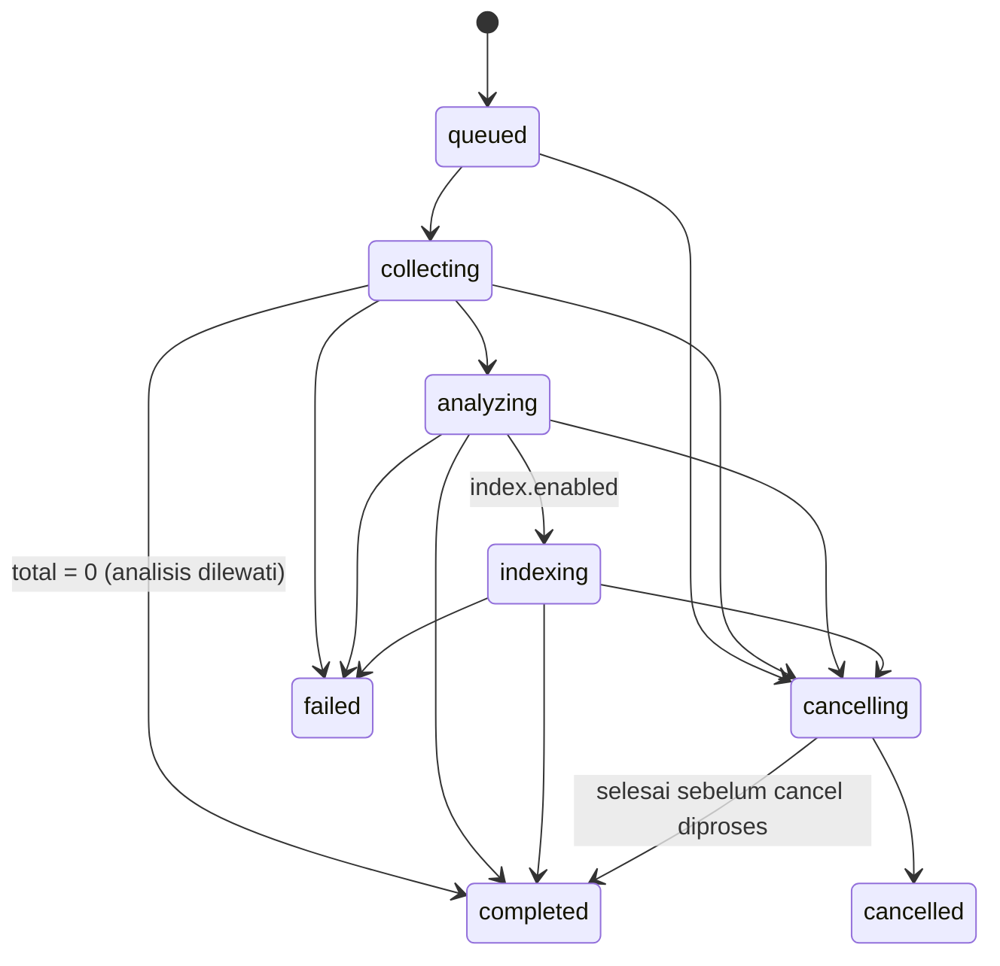

# Kontrak Integrasi 1.2 — Dashboard ↔ MCP ↔ LLM Gateway
## Modul 3: Data Scraping & Intelligence

| | |
|---|---|
| Versi kontrak | **1.2** (aditif terhadap 1.0 toolset `pm` dan 1.1 Service API — keduanya tidak berubah) |
| Sumber kebenaran schema | Dashboard: `backend/src/shared/schemas/intel.schema.ts` (Zod) · MCP: `mcp_marketing/schemas/intel.py` (Pydantic) — disinkronkan oleh fixture bersama ([TASK_000](M3_TASK_000_CONTRACT.md)) |
| Dokumen terkait | [Modul 1 M1_MCP_INTEGRATION](../modul1/M1_MCP_INTEGRATION.md) (HMAC & retry webhook), MCP `documentation/MCP_SPEC.md`, Gateway `docs/client-integration.md` |

---

### 1. Koneksi & Autentikasi

| Dari → Ke | Endpoint | Kredensial | Disimpan di |
|---|---|---|---|
| Dashboard → MCP (tool `intel_*`) | `MCP_SERVER_URL` (`http://localhost:4100/mcp`), MCP Streamable HTTP | `Authorization: Bearer <MCP_INTEL_API_KEY>` — key `mcpk_...` klien **`dashboard-intel`**, toolset **`intel` saja**, `rpm_limit 300` | `.env` Dashboard (backend) |
| Dashboard → MCP (tool `pm_*`, Modul 1) | sama | `MCP_SERVER_API_KEY` (tidak berubah) | `.env` Dashboard |
| MCP → Dashboard (webhook) | `POST {PUBLIC_API_URL}/webhooks/mcp/events` (endpoint Modul 1) | HMAC `MCP_WEBHOOK_SECRET` (header & retry sama dengan Modul 1 §5) | `.env` keduanya |
| MCP → Gateway | `LLM_GATEWAY_URL` (`http://127.0.0.1:8000/v1`) | Key `lgw_...` **milik agent tahap** (§4); fallback key `system`, lalu `LLM_GATEWAY_API_KEY` | MCP: tabel `mcp.llm_credentials` (terenkripsi) + `.env` |
| Gateway → OpenAI | — | `OPENAI_API_KEY` | `llm-genai/.env` saja |

Klien `dashboard-intel` dibuat sekali lewat MCP Admin API `POST /admin/clients` (`{"name": "dashboard-intel", "toolsets": ["intel"], "rpm_limit": 300}`); key lengkap hanya tampil sekali. Klien ini dipercaya membawa `workspace_id` (RBAC dilakukan Dashboard); MCP menyimpan `workspace_id` pada job dan **menolak** baca/batal job dengan `workspace_id` berbeda (`NOT_FOUND`).

---

### 2. Toolset `intel` (Dashboard → MCP)

Semua tool sinkron (≤ 15 s); pekerjaan panjang berjalan sebagai job MCP. Semua respons sukses berbentuk JSON di `structuredContent`; error mengikuti format MCP `{code, message, retryable, details}` (§5).

| Tool | Input | Output |
|---|---|---|
| `intel_agents_list` | `{}` | `{agents: AgentInfo[]}` |
| `intel_sources_status` | `{refresh?: bool}` | `{sources: SourceStatus[], llm: {routes: [{route, available}]}, checked_at}` |
| `intel_job_estimate` | `{workspace_id, spec: JobSpec}` | `Estimate` |
| `intel_job_create` | `{contract_version: "1.2", dashboard_job_id, workspace_id, requested_by: {user_id, name}, spec: JobSpec, confirm_cost: bool}` | `{accepted: true, mcp_job_id, estimate: Estimate}` — idempoten per `dashboard_job_id` |
| `intel_job_get` | `{workspace_id, mcp_job_id}` | `JobView` |
| `intel_job_cancel` | `{workspace_id, mcp_job_id}` | `{cancelled: bool, status}` — idempoten |
| `intel_items` | `{workspace_id, mcp_job_id, filter?: {source?, sentiment?: positive\|neutral\|negative, q? (≤ 100 char)}, order_by?: "-created_at"\|"created_at"\|"-engagement", limit ≤ 100 (default 50), cursor?}` | `{cols, rows, total, next_cursor, expires_at}` — `cols` = `id, source, posted_at, author, text, url, engagement, sentiment, score` |
| `intel_mission_plan` *(M3_TASK_013)* | `{workspace_id, mission_id, agent_key (profil dengan toolset task), title ≤ 150, instruction ≤ 4000, period: {start_date, end_date} ≤ 180 hari, context?: {insight_md? ≤ 6000, recommendations ≤ 10, existing_tasks ≤ 100}, available_agents ≤ 20, feedback? ≤ 1000, previous_plan?}` | `{plan: {summary, assumptions, risks: [{code: TIMELINE_TIGHT\|LOW_DATA\|OUT_OF_SCOPE\|OTHER, message}], tasks ≤ 15 (subtasks ≤ 8, total ≤ 60): [{ref, title, description, start_date, end_date, priority, tags, executor: agent\|human, agent_key?, depends_on}]}, cost: {llm_tokens, usd}}` — sinkron (timeout 360 s; bila output LLM tidak valid planner diminta ulang sekali), tidak menulis task; atribusi `X-Caller-Task: mission:<id>` |
| `intel_llm_status` | `{range_days: 7\|30}` | `{agents: [{agent_key, key_source: agent\|system\|env, key_prefix, key_status: active\|revoked\|invalid\|unknown, last_error?, usage: {calls, prompt_tokens, completion_tokens, usd}}], project: {slug, start, end, data: [...]}\|null}` |

#### 2.1 `AgentInfo`
```jsonc
{
  "agent_key": "researcher",
  "display_name": "Agent Researcher",
  "is_active": true,
  "route": "smart",
  "run_token_budget": 150000,
  "toolsets": ["pm_agent", "web", "social", "trends", "kb", "analysis", "data", "job"],
  "capabilities": ["collect", "analyze", "index"],   // turunan toolsets: collect=social|web|trends, analyze=analysis, index=kb
  "gateway_key": { "source": "agent", "prefix": "lgw_ab12" }   // source: agent|system|env
}
```

#### 2.2 `JobSpec`
```jsonc
{
  "title": "X · AI marketing tools · Okt 2026",          // 1–150
  "language": "id",                                       // id|en (bahasa laporan)
  "period": { "since": "2026-10-01", "until": "2026-10-30" },   // until ≥ since, rentang ≤ 366 hari
  "sources": [                                            // 1–4, maksimal satu per type
    { "type": "x", "keywords": ["AI marketing tools"], "match": "any", "lang": "id",
      "exclude_retweets": true, "exclude_replies": false, "max_items": 500, "provider": "auto" },
    { "type": "threads", "keywords": ["AI marketing"], "search_type": "RECENT", "max_items": 300 },
    { "type": "web", "mode": "scrape", "urls": ["https://contoh.id/artikel"] },
    // atau { "type": "web", "mode": "crawl", "start_url": "https://...", "max_pages": 50, "max_depth": 2, "include_patterns": ["/blog/"] }
    { "type": "trends", "keywords": ["AI marketing"], "geo": "ID" }
  ],
  "stages": {
    "collect": { "agent_key": "researcher" },
    "analyze": { "agent_key": "analyst", "aspects": ["harga", "fitur"], "method": "auto" },
    "index":   { "agent_key": "researcher", "enabled": false }        // P1
  }
}
```

| Field | Batas (sama di Zod & Pydantic) |
|---|---|
| `keywords` (x/threads) | 1–10 item, masing-masing 1–100 karakter |
| `keywords` (trends) | 1–5 item |
| `max_items` | x: 1–5.000 (default 500); threads: 1–2.000 (default 300) |
| `urls` | 1–50, hanya `http/https`, ≤ 2.048 karakter; SSRF dicek MCP |
| `max_pages` / `max_depth` | ≤ 200 / ≤ 3 |
| `aspects` | ≤ 10, masing-masing ≤ 40 karakter |
| `geo` | ISO-3166 (default `ID`) |

Sumber `trends` menghasilkan statistik minat & kueri terkait (bukan teks), sehingga tidak ikut analisis sentimen. Sumber `web` dianalisis per halaman (konten diringkas trafilatura).

#### 2.3 `Estimate`
```jsonc
{
  "seconds": 360,
  "sources": [ { "type": "x", "mode": "browser", "external_units": 500, "usd_external": 0.0 } ],
  "llm": { "tokens_est": 40000, "usd_est": 0.10, "by_stage": [ { "stage": "analyze", "agent_key": "analyst", "route": "smart", "tokens_est": 32000 } ] },
  "requires_confirmation": true,
  "warnings": [ { "code": "X_API_WINDOW", "message": "X API hanya 7 hari terakhir; memakai mode browser" } ]
}
```
`intel_job_create` dengan `requires_confirmation = true` tetapi `confirm_cost = false` → `COST_CONFIRMATION_REQUIRED`.

#### 2.4 `JobView`
```jsonc
{
  "mcp_job_id": "j_k3m9x2qa1b",
  "dashboard_job_id": "uuid",
  "status": "analyzing",          // queued|collecting|analyzing|indexing|completed|failed|cancelling|cancelled
  "stages": [
    { "stage": "collect", "agent_key": "researcher", "status": "completed", "progress": { "done": 500, "total": 500 },
      "started_at": "...", "finished_at": "...", "error": null },
    { "stage": "analyze", "agent_key": "analyst", "status": "running", "progress": { "done": 120, "total": 500 } }
  ],
  "result": {                        // null sampai completed (atau partial)
    "totals": { "items": 500, "by_source": { "x": 500 } },
    "sentiment": {
      "distribution": { "positive": 0.60, "neutral": 0.30, "negative": 0.10 },
      "net_sentiment": 0.50,
      "by_day": { "cols": ["day", "total", "positive", "neutral", "negative", "net"], "rows": [] },
      "aspects": { "cols": ["aspect", "mentions", "positive", "neutral", "negative", "net"], "rows": [] },
      "examples": { "positive": [ { "id": "...", "source": "x", "author": "@...", "text": "≤ 280 char", "url": "https://...", "created_at": "..." } ], "negative": [] }
    },
    "trends": { "topics": [ { "label": "otomasi konten", "count": 84, "share": 0.17 } ], "hashtags": [ ["#AI", 120] ], "authors": [ ["@akun", 14] ] },
    "volume_by_day": { "cols": ["day", "source", "count"], "rows": [] },
    "google_trends": null,          // {per_keyword:{...}, related:{top:{cols,rows}, rising:{cols,rows}}} bila sumber trends dipakai
    "summary_md": "## Ringkasan\n- ...",   // ≤ 4.000 karakter, markdown sederhana (heading, bullet, bold)
    "recommendations": ["..."],    // ≤ 5
    "items_handle": "h_7qk2m9x1za",
    "items_expire_at": "2026-12-04T00:00:00Z",
    "partial": false,
    "warnings": []
  },
  "cost": { "llm_tokens": 38211, "usd_llm": 0.094, "external_units": 500, "usd_external": 0.0,
            "by_stage": [ { "stage": "analyze", "agent_key": "analyst", "llm_tokens": 38211, "usd_llm": 0.094 } ] },
  "error": null                     // {code, message, retryable, stage} bila failed
}
```

#### 2.5 `SourceStatus`
```jsonc
{ "source": "x", "available": true, "mode": "browser", "detail": "X API token tidak ada; browser profile 'default' login ✓", "checked_at": "..." }
```
`mode`: `api` | `browser` | `unofficial` (Trends) | `none`.

---

### 3. Event Webhook `intel.job.*` (MCP → Dashboard)

#### 3.1 Envelope 1.2 (varian job)
Endpoint & header HMAC sama dengan Modul 1. Envelope Modul 1 (`run_id`, `agent_id`) tetap berlaku untuk event `agent.*`; event `intel.job.*` memakai varian berikut (Zod: union berdasarkan awalan `event_type`).

```jsonc
{
  "contract_version": "1.2",
  "event_id": "uuid",              // unik, dipakai idempotensi
  "event_type": "intel.job.progress",
  "occurred_at": "2026-11-04T08:00:00+07:00",
  "job_id": "uuid",                // dashboard_job_id
  "mcp_job_id": "j_k3m9x2qa1b",
  "sequence": 7,                   // naik ketat per job, mulai 1
  "data": { }
}
```

#### 3.2 Daftar event

| `event_type` | `data` | Efek di Dashboard |
|---|---|---|
| `intel.job.started` | `{}` | status `queued` → tetap; `started_at` |
| `intel.job.stage.started` | `{stage, agent_key}` | stage `running`; job `collecting`/`analyzing`/`indexing` |
| `intel.job.progress` | `{stage, done, total, message?}` (dikirim tiap ≥ 10% atau ≥ 30 s) | update progres (tanpa activity log) |
| `intel.job.stage.completed` | `{stage, stats?, warnings[]}` | stage `completed` / `skipped` |
| `intel.job.completed` | `{summary_preview (≤ 500), totals, cost, partial}` | backend memanggil `intel_job_get`, menyimpan `intel_insights`, job `completed` |
| `intel.job.failed` | `{stage, error: {code, message, retryable}}` | job & stage `failed` |
| `intel.job.cancelled` | `{}` | job `cancelled`, stage aktif `cancelled` |

#### 3.3 Aturan pemrosesan
- Satu webhook in-flight per job; MCP mengirim urut `sequence`. Dashboard menyimpan `last_event_sequence` dan **mengabaikan** event dengan `sequence ≤ last_event_sequence` (200).
- `event_id` duplikat → 200 tanpa perubahan (tabel `mcp_webhook_events` Modul 1 dipakai ulang).
- `job_id` tidak dikenal → 404 `NOT_FOUND`; event setelah job terminal (kecuali duplikat) → 409 `JOB_NOT_ACTIVE`. Keduanya membuat MCP **berhenti** retry event tsb.
- Retry & backoff mengikuti Modul 1 (`WEBHOOK_MAX_RETRY_MINUTES`). Bila webhook gagal permanen, sweeper Dashboard (tiap 2 menit untuk job non-terminal > 2 menit tanpa event) memanggil `intel_job_get` untuk menyelaraskan status.

#### 3.4 State machine (Dashboard & MCP sama)


`completed`, `failed`, `cancelled` terminal. Retry = job baru.

---

### 4. LLM Gateway — Key per Agent & Atribusi

| Aspek | Aturan |
|---|---|
| Project Gateway | `marketing-mcp`, allowed models `fast`, `smart`, `embed-default`; quota harian/bulanan (token & `max_cost_usd`) diatur admin Gateway |
| Key | Satu `lgw_...` per agent (`researcher`, `analyst`, `strategist`) + `system` (embedding, estimasi, klasifikasi tanpa agent). Scope: `chat`, `embeddings`, `models:read`, `usage:read` |
| Penyimpanan | MCP `mcp.llm_credentials` — AES-256-GCM dengan `MCP_SECRET_KEY` (32 byte, base64, berbeda dari secret lain); hanya prefix yang pernah keluar dari MCP |
| Pemilihan key | Panggilan LLM pada tahap X memakai key `agent_key` tahap tsb → key `system` → `LLM_GATEWAY_API_KEY` (env). `intel_agents_list.gateway_key.source` menunjukkan yang dipakai |
| Header | `X-Request-Id` (diteruskan dari Dashboard bila ada), `X-Caller-Agent: <agent_key>`, `X-Caller-Task: intel:<mcp_job_id>:<stage>`, `user: <client_id>:<mcp_job_id>` |
| Pencatatan | `mcp.llm_calls` ditambah kolom `agent_key`, `job_id`, `stage`, `cost_usd` → sumber `cost` di `JobView` & `intel_llm_status` |
| Pemakaian project | `intel_llm_status` memanggil Gateway `GET /v1/usage` dengan key `system` (scope `usage:read`) |
| Provisioning (P0) | Skrip MCP `manage.py gateway-keys provision` memakai admin key Gateway yang **dimasukkan saat dijalankan** (tidak disimpan), membuat project + key, lalu menyimpan terenkripsi |
| Rotasi (P1) | `intel_gateway_key_rotate` (scope admin MCP) → Gateway `POST /admin/keys/{id}/rotate` |

Pemetaan error Gateway → MCP:

| Gateway | Kode MCP | Retryable |
|---|---|---|
| 401/403 `invalid_api_key`, `scope_denied`, `model_not_allowed`, `project_suspended` | `LLM_KEY_INVALID` | tidak |
| 429 `quota_exceeded` | `LLM_QUOTA_EXCEEDED` | tidak (sampai periode kuota berikut) |
| 429 `rate_limited` | ditangani internal (backoff `Retry-After`), lalu `LLM_UNAVAILABLE` | ya |
| 502/503/504 | `LLM_UNAVAILABLE` | ya |
| 400 `context_length_exceeded` | sampel diperkecil 1× otomatis, lalu `LLM_REQUEST_INVALID` | tidak |

---

### 5. Kode Error

| Kode MCP | Kapan | HTTP di API Dashboard |
|---|---|---|
| `VALIDATION_ERROR` | Spec tidak valid | 400 |
| `UNKNOWN_AGENT` | `agent_key` tidak ada di MCP | 422 |
| `AGENT_INACTIVE` | Profil agent nonaktif | 422 |
| `AGENT_NOT_CAPABLE` | Toolset profil tidak mencakup kapabilitas tahap | 422 |
| `COST_CONFIRMATION_REQUIRED` | Estimasi butuh konfirmasi | 422 |
| `SOURCE_UNAVAILABLE` | Sumber tidak bisa dipakai (token kosong & browser tidak login, dll.) | 422 (estimate/create) / event `failed` |
| `NOT_FOUND` | Job tidak ada atau `workspace_id` berbeda | 404 |
| `JOB_NOT_ACTIVE` | Batal pada job terminal | 409 |
| `RESULT_EXPIRED` | `items_handle` melewati retensi | 410 |
| `BUDGET_EXCEEDED` | Budget token agent/tahap habis | event `failed` (hasil parsial bila ada) |
| `LLM_KEY_INVALID`, `LLM_QUOTA_EXCEEDED`, `LLM_UNAVAILABLE`, `LLM_REQUEST_INVALID` | §4 | event `failed` |
| `WORKER_LOST` | Heartbeat job kedaluwarsa | event `failed` (retryable) |
| `RATE_LIMITED` | Rate limit klien MCP | 429 |
| `INTERNAL` | Lainnya | 502 `MCP_ERROR` |
| (koneksi gagal / timeout) | MCP tidak terjangkau | 502 `MCP_UNAVAILABLE` |

---

### 6. Kompatibilitas & Versi
- Toolset `pm` (1.0) dan Service API (1.1) **tidak berubah**; envelope `agent.*` tetap memakai `run_id`/`agent_id`.
- Dashboard menerima `contract_version` `1.x`; field tambahan tak dikenal di `data` diabaikan (forward-compatible), field wajib hilang → 400.
- Perubahan breaking berikutnya = versi `2.0` dengan masa transisi kedua versi diterima.

---

### 7. Catatan Implementasi (TASK_000 & TASK_007, 4 Nov 2026)

| Topik | Keputusan saat implementasi |
|---|---|
| Fixture bersama | Sumber: repo MCP `contracts/intel-1.2/` (50 fixture + `SHA256SUMS`). Bangkitkan & salin: `python scripts/export_intel_fixtures.py --dashboard <path marketingdashboardjtp>`. Diuji `mcp/tests/unit/test_intel_contract.py` dan `backend/test/contract/intel-fixtures.spec.ts` |
| Analisis pasar | `market_analysis` & `report_id` **ditunda** (tidak ada di kontrak 1.2); bisa ditambah aditif di 1.3 |
| Tahap `index` | Diterima di schema, tetapi `enabled: true` → `VALIDATION_ERROR` sampai [TASK_010](M3_TASK_010_KNOWLEDGE_BASE.md) |
| Ambang konfirmasi biaya | Konstanta `CONFIRM_USD_THRESHOLD = 1.0` di `services/intel/estimate.py` (bukan env); konfirmasi juga wajib bila `usd_external > 0` |
| Harga LLM | Perkiraan per 1.000 token: `fast` USD 0,0006, `smart` USD 0,005 (profil `remote-only`). Klasifikasi sentimen selalu di tier `fast`; sintesis di route agent tahap Analisis |
| Job induk | Kind `intel_pipeline`, `max_attempts = 1` (gagal = final; Dashboard mengulang dengan job baru). Sumber dijalankan berurutan sebagai job anak (`parent_job_id`) di dalam slot worker induk |
| Satu sumber gagal | Bila job punya > 1 sumber, sumber gagal menjadi warning `SOURCE_FAILED` dan job tetap jalan; bila satu-satunya sumber gagal → `SOURCE_UNAVAILABLE` |
| Model sentimen lokal | Bila `SENTIMENT_MODEL_DIR` kosong, semua item diklasifikasi LLM (warning `SENTIMENT_MODEL_MISSING` di estimasi) |
| Key Gateway | Sampai [TASK_009](M3_TASK_009_LLM_GATEWAY_KEYS.md): semua agent memakai `LLM_GATEWAY_API_KEY` (`gateway_key.source = "env"`), tetapi atribusi `X-Caller-Agent`/`X-Caller-Task` + `mcp.llm_calls.agent_key/job_id/stage` sudah aktif |
| Klien Dashboard | Buat sekali: `scripts\conda-run.bat python scripts\manage.py create-client --name dashboard-intel --toolsets intel --rpm 300` (atau `POST /admin/clients` dengan `rpm_limit: 300`); simpan key di `.env` Dashboard sebagai `MCP_INTEL_API_KEY` (TASK_002) |
