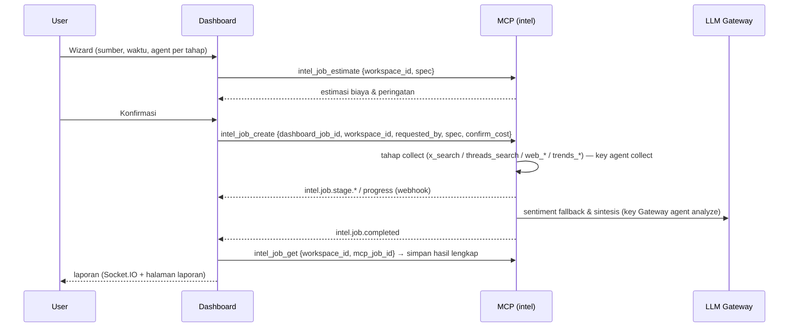

# Product Requirements Document (PRD)
## Modul 3: Data Scraping & Intelligence

| | |
|---|---|
| Versi | 1.0 |
| Status | Disetujui arah (4 Nov 2026) — detail menunggu review tim |
| Dokumen terkait | [README](README.md), [Use Cases](M3_USE_CASES.md), [Kontrak MCP 1.2](M3_MCP_INTEGRATION.md), [Review](M3_REVIEW.md) |

---

### 1. Latar Belakang & Visi
Tim marketing perlu memantau percakapan publik (X, Threads, situs web) dan minat pencarian (Google Trends) tentang brand, produk, dan kompetitor, lalu mengubahnya menjadi laporan yang bisa langsung dipakai. Repo MCP Marketing sudah menyediakan toolset `intel` 1.2 untuk koleksi, analisis, status sumber, biaya, dan event job; LLM Gateway menyediakan model, key, kuota, dan pencatatan pemakaian. Yang belum ada di produk Dashboard adalah **antarmuka Modul 3** serta wiring backend dan webhook ke toolset tersebut.

Visi: **"Tentukan topik, pilih agent, konfirmasi biaya — laporan intelijen siap dibaca tanpa menyentuh terminal."**

### 2. Tujuan & Ukuran Keberhasilan

| Tujuan | Indikator (saat UAT) |
|---|---|
| Integrasi end-to-end berjalan | Job X keyword 500 post + analisis sentimen selesai di stack lokal (`--no-runtime`) < 10 menit, status tampil real-time |
| Agent bisa dipilih & dipertanggungjawabkan | Setiap tahap mencatat agent pelaksana; agent tanpa kapabilitas yang sesuai ditolak oleh MCP |
| Biaya terkendali & terlihat | Estimasi biaya tampil sebelum dijalankan; biaya aktual (LLM + API eksternal) tampil per job & per agent; selisih estimasi vs aktual ≤ 30% untuk job X 500 post |
| Aman | 0 secret provider / key `lgw_...` di Dashboard; webhook tanpa HMAC valid ditolak; data workspace lain tidak bisa dibaca (anti-IDOR) |
| Mudah dibaca | Manajer bisa menyebut sentimen dominan + 3 tren teratas dari halaman laporan dalam < 30 detik (uji 3 orang) |

### 3. Persona & Hak Akses (RBAC workspace Modul 1)

| Aksi | Owner | Admin | Member | Viewer |
|---|---|---|---|---|
| Lihat daftar job, laporan, data mentah | ✓ | ✓ | ✓ | ✓ |
| Ekspor | ✓ | ✓ | ✓ | ✓ |
| Buat job, retry | ✓ | ✓ | ✓ | – |
| Batalkan job | ✓ | ✓ | pembuat | – |
| Hapus job (soft delete) | ✓ | ✓ | pembuat | – |
| Lihat halaman **AI & Gateway** (status key, pemakaian, biaya) | ✓ | ✓ | – | – |
| Atur agent default per tahap untuk workspace | ✓ | ✓ | – | – |

### 4. Konsep Utama

| Istilah | Arti |
|---|---|
| **Job riset** | Satu permintaan pengumpulan + analisis. Disimpan di Dashboard (`intel_jobs`) dan di MCP (job induk `intel`) |
| **Sumber** | Satu konfigurasi koleksi dalam job: `x`, `threads`, `web`, atau `trends` (1–4 sumber per job) |
| **Tahap** | P0: `collect` (kumpulkan) → `analyze` (sentimen, tren, ringkasan). `index` adalah P1 dan tidak boleh diaktifkan sampai pipeline MCP menjalankan tahap itu; field opsional di kontrak saja belum menjamin dukungan runtime |
| **Agent** | Agent workspace (tabel `agents`) yang dipetakan ke profil MCP lewat `mcp_agent_key`. Agent menentukan route LLM, budget token, prompt, dan **key Gateway** yang dipakai pada tahap tersebut |
| **Kapabilitas** | Turunan dari toolset profil agent: `collect` butuh `social`/`web`/`trends`; `analyze` butuh `analysis`; `index` butuh `kb` |
| **Key Gateway** | Key `lgw_...` milik satu agent di project Gateway `marketing-mcp`; disimpan terenkripsi di MCP |

### 5. Requirement Fungsional

| ID | Requirement | Prioritas | Task |
|---|---|---|---|
| FR-01 | Menu **"Riset & Insight"** di sidebar workspace: daftar job (status, sumber, agent, jumlah data, biaya, waktu) dengan filter status/sumber | P0 | 004 |
| FR-02 | Wizard buat job 4 langkah: (1) sumber & target, (2) rentang waktu & batas data, (3) **agent per tahap**, (4) estimasi & konfirmasi | P0 | 002, 004 |
| FR-03 | Sumber `x`: keyword ≤ 10, `match any/all`, bahasa, kecualikan retweet/reply, `max_items` ≤ 5.000 | P0 | 007 |
| FR-04 | Sumber `threads`: keyword ≤ 10, `TOP/RECENT`, `max_items` ≤ 2.000 | P0 | 007 |
| FR-05 | Sumber `web`: daftar URL ≤ 50 (`scrape`) atau 1 URL awal (`crawl`, ≤ 200 halaman, kedalaman ≤ 3) | P0 | 007 |
| FR-06 | Sumber `trends`: keyword ≤ 5, geo (default `ID`), interest over time + related queries | P0 | 007 |
| FR-07 | Pemilihan agent per tahap dari agent workspace yang **mampu**; default workspace dapat diatur admin; MCP memvalidasi ulang | P0 | 008 |
| FR-08 | Estimasi sebelum jalan: durasi, unit API eksternal, biaya eksternal (USD), perkiraan token & biaya LLM, peringatan (mis. X > 7 hari → mode browser) | P0 | 007, 004 |
| FR-09 | Status real-time per tahap (antre, mengumpulkan n/N, menganalisis, selesai, gagal, dibatalkan) via Socket.IO | P0 | 002, 004 |
| FR-10 | Batalkan job yang sedang berjalan; MCP menghentikan job anak & panggilan LLM berikutnya | P0 | 002, 007 |
| FR-11 | Retry job gagal/dibatalkan → job baru dengan parameter sama (dapat diubah sebelum dikirim) | P0 | 002, 004 |
| FR-12 | Laporan insight: ringkasan eksekutif, distribusi sentimen + `net_sentiment`, tren/topik teratas, hashtag & akun teratas, aspek (bila diminta), contoh post positif/negatif, grafik volume per hari, data Google Trends | P0 | 005 |
| FR-13 | Raw data explorer: tabel paginasi server-side, cari teks, filter sumber & sentimen, buka tautan asli | P0 | 002, 005 |
| FR-14 | Ekspor: data mentah CSV (streaming, ≥ 5.000 baris), laporan insight PDF/XLSX (reuse util Modul 2) | P0 | 002, 005 |
| FR-15 | Kartu "Dikerjakan oleh" (agent per tahap) + biaya aktual (token, USD LLM, unit & USD eksternal) per job | P0 | 005, 009 |
| FR-16 | Halaman **Sumber & Koneksi** (read-only): status X API/browser, Threads API/browser, Web, Trends, dan route LLM via `intel_sources_status` | P0 | 007, 004 |
| FR-17 | Halaman **AI & Gateway** (admin): per agent → route, prefix key Gateway, sumber key (agent/fallback), status, pemakaian & biaya 7/30 hari; pemakaian project Gateway | P0 | 009 |
| FR-18 | Rotasi key Gateway per agent dari Dashboard | P1 | 009 |
| FR-19 | Opsi "Simpan ke Knowledge Base" agar agent Modul 1 dapat memakai hasil via `kb_search` | P1 | 010 |
| FR-20 | Visualisasi 3D live data yang masuk ke Knowledge Base | P2 | 011 |
| FR-21 | Collector Meta (Facebook/Instagram) | P2 | 012 |
| FR-22 | Mode agentic penuh (agent memutuskan tool sendiri) & jadwal berulang | P2 | — |

### 6. Alur Kerja (ringkas)

### 7. Requirement Non-Fungsional

| ID | Kategori | Requirement |
|---|---|---|
| NFR-01 | Keamanan secret | `OPENAI_API_KEY` hanya di `llm-genai/.env`; key `lgw_...` hanya di MCP (terenkripsi); key MCP `dashboard-intel` khusus toolset `intel` hanya di backend Dashboard; frontend tidak pernah menerima secret |
| NFR-02 | Keamanan integrasi | Webhook HMAC + `event_id` idempoten (pola Modul 1); key MCP Dashboard khusus toolset `intel`; MCP memeriksa `workspace_id` pada setiap baca/batal job dan data |
| NFR-03 | Validasi | Zod di Dashboard + Pydantic di MCP dengan batas yang sama (TASK_000); URL hanya http/https, SSRF dicek MCP |
| NFR-04 | Performa | Daftar job p95 < 300 ms; halaman raw data p95 < 800 ms untuk job 5.000 item (paginasi 50); ekspor CSV 5.000 baris < 15 s tanpa memblokir event loop |
| NFR-05 | Keandalan | MCP/Gateway mati tidak mengganggu fitur Dashboard lain; job gagal menampilkan kode & pesan yang dapat ditindaklanjuti; event diproses idempoten & berurutan per job |
| NFR-06 | Biaya | Estimasi wajib dikonfirmasi bila biaya eksternal > 0 atau perkiraan LLM > ambang workspace (default USD 1); budget token per tahap mengikuti profil agent |
| NFR-07 | Observability | `X-Request-Id` lintas Dashboard → MCP → Gateway; header `X-Caller-Agent`, `X-Caller-Task=intel:<job>:<stage>`; log terstruktur dengan `job_id` |
| NFR-08 | Aksesibilitas & bahasa | Sama dengan Modul 2 (WCAG AA, bahasa Indonesia, format `id-ID`, grafik punya tabel alternatif) |
| NFR-09 | Kualitas | Coverage ≥ 80% modul baru di Dashboard & MCP; contract test lintas repo; E2E UC-M3-01…04 |
| NFR-10 | Kepatuhan | Scraping menghormati `robots.txt` & rate per domain (setting MCP); mode browser untuk X/Threads memakai akun milik tim dan tunduk pada ToS platform — risiko dicatat di halaman Sumber & Koneksi |

### 8. Di Luar Scope Rilis Pertama
- Collector Meta (P2), mode agentic penuh, jadwal berulang, perbandingan antar job.
- Penyimpanan atau pengelolaan token X/Threads/proxy dari Dashboard (tetap di MCP).
- Pembuatan key Gateway dari Dashboard (P0 lewat skrip; rotasi dari UI = P1).
- Penyalinan data mentah ke DB Dashboard.
- Visualisasi 3D (P2).

### 9. Risiko

| Risiko | Mitigasi |
|---|---|
| Mode browser X/Threads butuh akun login & mudah berubah selector | Tampilkan status `available`/`mode`/`detail` dari `intel_sources_status`; peringatan di estimasi; gunakan API bila tersedia |
| Biaya X API & LLM membengkak | Estimasi + konfirmasi, `max_items`, budget per agent, kuota project Gateway |
| Satu key Gateway bocor | Key per agent (blast radius kecil), terenkripsi di MCP, rotasi via skrip/Admin API |
| Kontrak dua repo tidak sinkron | Kontrak 1.2 + fixture bersama + contract test di kedua repo (TASK_000) |

### 10. Kriteria Rilis Modul 3
1. Semua FR P0 selesai; FR P1 selesai atau disembunyikan.
2. UC-M3-01 s.d. 06 lulus UAT di stack nyata.
3. Semua kriteria [TASK_006](M3_TASK_006_QA_DEPLOYMENT.md) terpenuhi.
