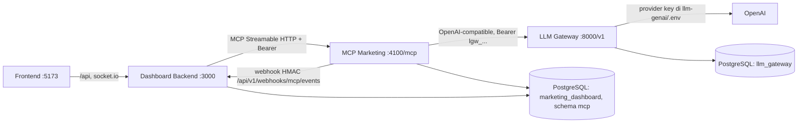
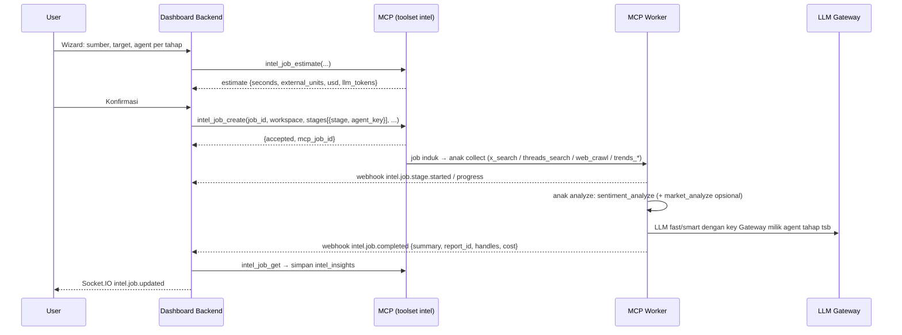
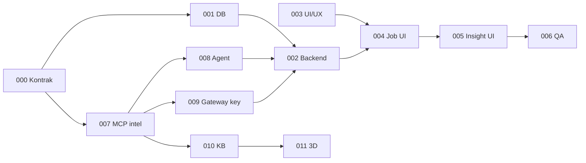

# Review Modul 3 — Data Scraping & Intelligence
## Kesesuaian dengan MCP Marketing & LLM Gateway

| | |
|---|---|
| Tanggal review | 4 November 2026 |
| Dokumen yang direview | `M3_PRD`, `M3_USE_CASES`, `M3_MCP_INTEGRATION`, `M3_TASK_001` – `M3_TASK_006` (draf 4 Nov 2026) |
| Dicek terhadap | `mcp` (github.com/senavahni/mcp-custom-by-fr, commit `8cb78f8`), `llm-genai` (github.com/senavahni/llm-genai, commit `2c851f7`), `marketingdashboardjtp` (Modul 1 & 2) |
| Objektif Modul 3 | Dashboard berhasil memakai MCP (agent + tool scraping/analisis) yang semua panggilan LLM-nya lewat LLM Gateway |
| Status | **Usulan diterima (4 Nov 2026).** Seluruh dokumen Modul 3 sudah ditulis ulang — mulai dari [README.md](README.md). Draf awal disimpan di [`_arsip_draf/`](_arsip_draf/). Nama file task final: lihat README §3 |

---

### 1. Ringkasan

Draf Modul 3 ditulis seolah-olah MCP belum punya kemampuan scraping & analisis, sehingga mendesain ulang hal yang **sudah ada** dan memakai kontrak yang **tidak ada** di MCP. Arah produknya (job → kumpulkan data → analisis → laporan insight) sudah tepat, tetapi tiga hal harus diubah sebelum mulai coding:

1. **Kontrak MCP di draf tidak cocok dengan MCP nyata.** Tool `scraping_create_job` / `scraping_cancel_job` dan event `agent1.*` / `agent2.*` tidak ada. MCP sudah punya `x_search`, `threads_search`, `web_scrape`, `web_crawl`, `trends_*`, `sentiment_analyze`, `market_analyze`, `kb_ingest`, `job_status`/`job_cancel`, `data_get`/`data_export`, dan report — semuanya asinkron lewat job.
2. **Dashboard saat ini tidak boleh memanggil tool tersebut.** Key Dashboard (`MCP_SERVER_API_KEY`) dipetakan ke toolset `pm` saja (`mcp_marketing/server/auth.py`). Perlu klien MCP baru atau toolset baru (lihat §4).
3. **Pemilihan agent dan sistem API key LLM Gateway belum dirancang** — sesuai dugaan Anda. "Agent 1 / Agent 2" di draf harus dipetakan ke profil agent MCP (`researcher`, `analyst`, `strategist`), dan saat ini semua panggilan LLM MCP memakai **satu** `LLM_GATEWAY_API_KEY` sehingga biaya/kuota tidak bisa dibedakan per agent atau per job.

Penilaian per dokumen ada di §3; usulan task baru di §6; keputusan yang perlu Anda ambil di §7.

---

### 2. Kondisi Nyata Ketiga Project (yang relevan untuk Modul 3)

| Area | Yang sudah ada | Sumber |
|---|---|---|
| Koleksi data | `x_search` (X API ≤ 7 hari, selebihnya browser), `threads_search` (Threads API / browser), `web_scrape` (≤ 50 URL), `web_crawl` (≤ 200 halaman), `trends_interest` / `trends_by_region` / `trends_related` (Google Trends) | `MCP_SPEC §4.5–4.7` |
| Platform **Meta (Facebook/Instagram)** | **Belum ada** collector | — |
| Analisis | `sentiment_analyze` (model lokal → fallback LLM `fast` bila confidence < 0,60; aspek; `net_sentiment`; contoh positif/negatif), `market_analyze` (SWOT, share of voice, dll.), `report_get` | `MCP_SPEC §4.10` |
| Vector DB | pgvector di schema `mcp`: `kb_ingest`, `kb_search` (hybrid), embedding via Gateway `embed-default` | `MCP_SPEC §4.9` |
| Job asinkron | Tabel `mcp.jobs` (progress, `parent_job_id`, `cancel_requested`, `estimate {seconds, external_units, usd}`, retry, heartbeat) + worker | `models/jobs.py` |
| Data mentah | Disimpan MCP di `mcp.result_sets` / `result_items` (akses via `handle`), dengan retensi `SOCIAL_RETENTION_DAYS` / `RAW_RETENTION_DAYS` | `MCP_SPEC §3 T2` |
| Agent | Profil `strategist`, `researcher`, `analyst` (toolset, route LLM, budget token, max steps) di `mcp.agent_profiles` | `services/agent/profiles.py` |
| Agent di Dashboard | Tabel `agents.mcp_agent_key`; seed: `strategist`, `researcher`, `assistant`. **`analyst` belum terdaftar** di Dashboard | `seed.ts` |
| Kontrak Dashboard ↔ MCP | Toolset `pm` (5 tool), webhook `agent.task.*`, `agent.block.appended`, dll. — **semuanya berbasis task/run Modul 1**, belum ada event job | `mcp.schema.ts` |
| Klien MCP | Key `mcpk_<prefix>_<secret>` per klien dengan `toolsets`, `workspace_id`, `rpm_limit`, `daily_token_budget`; dibuat via `POST /admin/clients` | `server/admin.py` |
| LLM Gateway | Project → API key `lgw_...` (scope, rpm/tpm per key) → allowed models per project → quota harian/bulanan (request, token, cost USD). Admin API `/admin/projects/{id}/keys` (create/revoke/rotate) | `app/models/*`, `routes/admin/*` |
| Route Gateway (profil `remote-only`, `--no-runtime`) | `fast` → gemini-flash → claude-haiku → **gpt-light (gpt-5-mini)**; `smart` → claude-sonnet → **gpt-heavy (gpt-5)**; `embed-default` → **OpenAI text-embedding-3-small**. Dengan hanya `OPENAI_API_KEY`, ketiga route tetap jalan (provider tanpa key dilewati otomatis) | `scripts/profiles/remote-only.yaml` |
| MCP → Gateway | **Satu** `LLM_GATEWAY_API_KEY` untuk semua agent & tool; korelasi lewat header `X-Request-Id` + `user=<client_id>:<run_id>`; usage dicatat di `mcp.llm_calls` | `gateway_client.py`, `MCP_SPEC §6` |

---

### 3. Review per Dokumen

Tingkat: **Tinggi** = harus diubah sebelum implementasi · **Sedang** = sebaiknya diubah · **Rendah** = rapikan.

#### 3.1 `M3_PRD.MD`
| # | Temuan | Tingkat | Usulan |
|---|---|---|---|
| P1 | Belum ada objektif integrasi (MCP + Gateway), ukuran keberhasilan, persona/RBAC, FR/NFR, di luar scope — format belum seperti PRD Modul 1/2 | Tinggi | Tulis ulang dengan struktur M1/M2: tujuan & indikator (mis. "1 job X 500 post selesai end-to-end < 10 menit di stack lokal; 0 secret provider di Dashboard"), FR bernomor ber-prioritas, NFR |
| P2 | Platform "Web, Twitter/X, Threads, **Meta**" — Meta belum ada di MCP; Google Trends ada di MCP (dan di mockup 3D) tetapi tidak disebut | Tinggi | Platform P0: **Web, X, Threads, Google Trends**. Meta → P2 / di luar scope (butuh Meta Graph API + app review), atau task MCP baru |
| P3 | "Agent 1 (Scraper)" dan "Agent 2 (Analyst)" adalah konsep baru, tidak memakai profil agent MCP | Tinggi | Petakan: tahap **Kumpulkan** → agent dengan toolset `social/web/trends` (default `researcher`); tahap **Analisis** → agent dengan toolset `analysis` (default `analyst`). User **memilih agent** per tahap di wizard (lihat T-AGENT §6) |
| P4 | "Credential & Proxy Management" di Dashboard menyimpan API key/proxy — bertentangan dengan arsitektur: token X/Threads, browser profile & proxy hidup di MCP (`.env` + `browser_profiles`), provider key LLM (OpenAI) hidup di Gateway | Tinggi | Dashboard **tidak menyimpan secret provider apa pun**. Ganti fitur ini menjadi **"Sumber & Koneksi"** (read-only: status X API, Threads API, browser profile login, route LLM tersedia) + **"AI & Gateway"** (pemetaan agent → key/route Gateway, kuota & biaya) — lihat §5 |
| P5 | Tidak ada estimasi & konfirmasi biaya — padahal X API berbayar per read (`X_PRICE_PER_READ_USD` 0,005 → 500 post ≈ $2,5) dan LLM berbayar per token | Tinggi | Wizard menampilkan `estimate` dari MCP (durasi, unit eksternal, USD) dan meminta konfirmasi; job menyimpan biaya aktual (LLM + eksternal) |
| P6 | Belum disebut vector DB, padahal mockup 3D bergantung pada "data masuk ke vector DB" | Sedang | Tambah langkah opsional **Simpan ke Knowledge Base** (`kb_ingest` koleksi per workspace/job) — juga berguna agar agent Modul 1 bisa memakai hasil scraping via `kb_search` |
| P7 | Retry, jadwal berulang, perbandingan antar job tidak dibahas | Rendah | Retry = buat ulang job dengan parameter sama (P0); jadwal berulang (MCP sudah punya `mcp.schedules`) → P2 |

#### 3.2 `M3_USE_CASES.MD`
| # | Temuan | Tingkat | Usulan |
|---|---|---|---|
| U1 | Tidak ada aktor/prasyarat/alur alternatif/error seperti M1/M2 | Sedang | Samakan format; tambahkan prasyarat nyata: browser profile login X (`browser_profile_check`), X API hanya 7 hari terakhir, Gateway & worker MCP berjalan |
| U2 | UC2 "Agent 1 menyimpan 500 tweet ke database/storage" — penyimpanan di MCP (`result_sets`), bukan Dashboard | Tinggi | Dashboard hanya menyimpan referensi `handle` + statistik; tampilan raw data membaca via MCP `data_get` |
| U3 | UC3 "MCP Server memicu Agent 2" — draf ragu siapa yang merantai (Dashboard atau MCP) | Tinggi | **MCP yang merantai** (satu job induk + job anak per tahap) agar Dashboard cukup menerima event; Dashboard tidak menjadi orchestrator |
| U4 | Tidak ada UC untuk memilih agent, pengaturan key Gateway, kegagalan LLM (kuota habis `429 quota_exceeded`, `BUDGET_EXCEEDED`), cancel di tengah tahap analisis | Tinggi | Tambah UC5 Pilih agent & lihat estimasi, UC6 Kelola AI & Gateway (admin), UC7 Kegagalan & retry, UC8 Simpan ke KB / dipakai agent Modul 1 |

#### 3.3 `M3_MCP_INTEGRATION.MD`
| # | Temuan | Tingkat | Usulan |
|---|---|---|---|
| I1 | Tool `scraping_create_job`, `scraping_cancel_job` tidak ada di MCP; parameter `credentials_ref` tidak punya padanan | Tinggi | Ganti dengan toolset baru **`intel`** di MCP (didesain di T-MCP §6): `intel_job_create`, `intel_job_get`, `intel_job_cancel`, `intel_agents_list`, `intel_sources_status`, `intel_items` (proxy `data_get` dengan scope workspace) |
| I2 | Event `agent1.scrape.*` / `agent2.analysis.*` bukan format MCP | Tinggi | Event baru berawalan **`intel.job.`**: `queued`, `stage.started`, `progress`, `stage.completed`, `completed`, `failed`, `cancelled` — dikirim lewat **endpoint webhook yang sudah ada** `POST /api/v1/webhooks/mcp/events` (HMAC + `event_id` idempoten), bukan endpoint baru |
| I3 | Dokumen menyebut "Backend **Modul 2**" — salah nomor modul | Rendah | Ganti "Modul 3" |
| I4 | Payload `agent2.analysis.completed` mengirim hasil penuh lewat webhook | Sedang | Webhook cukup membawa ringkasan + `report_id`/`handle`; detail diambil Dashboard via `intel_job_get` (batas body webhook 1 MB) |
| I5 | Belum mengatur outbox: MCP saat ini menjamin urutan **per run**, bukan per job | Sedang | Outbox MCP menambah kunci urutan per `job_id` |

#### 3.4 `M3_TASK_001_DB_SECURITY`
| # | Temuan | Tingkat | Usulan |
|---|---|---|---|
| D1 | `scraping_jobs.user_id` — tidak ada scoping workspace (RBAC Modul 1) | Tinggi | `workspace_id` + `created_by`; RBAC sama dengan M2 (viewer baca, member buat, pembuat/admin batal/hapus) |
| D2 | Tabel `scraped_raw_data` menduplikasi data yang sudah disimpan MCP | Tinggi | **Hapus.** Simpan `mcp_job_id`, `result_handle`, `total_items`, statistik ringkas. Raw data dibaca on-demand dari MCP |
| D3 | Tabel `credentials` + AES di Dashboard | Tinggi | **Hapus dari P0** (lihat P4). Bila nanti Dashboard perlu mengelola token X/Threads, simpan terenkripsi di **MCP**, Dashboard hanya kirim id |
| D4 | Tabel `insights` kurang kolom | Sedang | `intel_insights(job_id, summary_md, sentiment_json, trends_json, aspects_json, examples_json, report_id, generated_by_agent_id, llm_tokens, cost_usd, formula/prompt_version)` |
| D5 | Validasi `target_value` menyebut "NoSQL injection" — tidak relevan (PostgreSQL + Zod) | Rendah | Ganti: validasi URL http/https (SSRF dicek ulang di MCP `ssrf.py`), batas jumlah keyword/URL, rentang tanggal, `max_items` sesuai batas tool MCP |
| D6 | Belum ada tabel per tahap | Sedang | `intel_job_stages(job_id, stage: collect\|analyze\|kb_ingest, agent_id, status, progress_done/total, mcp_job_id, error, started_at, finished_at)` — sumber untuk timeline status & pemilihan agent per tahap |

#### 3.5 `M3_TASK_002_BACKEND_API`
| # | Temuan | Tingkat | Usulan |
|---|---|---|---|
| B1 | Endpoint webhook baru `mcp-scraping-events` | Tinggi | Pakai endpoint webhook yang sudah ada; perluas Zod `mcp.schema.ts` dengan discriminated union `intel.job.*` |
| B2 | Belum ada klien MCP untuk toolset baru | Tinggi | `McpClientService` ditambah tool `intel_*` dengan **key MCP terpisah** (`MCP_INTEL_API_KEY`, `mcpk_...` toolset `intel`) agar tidak memperluas key `pm` |
| B3 | Real-time hanya disebut di frontend (polling) | Sedang | Backend memancarkan event Socket.IO `intel.job.updated` ke room workspace (gateway Modul 1 sudah ada) |
| B4 | Export CSV dibangun ulang | Sedang | Raw data: proxy streaming dari MCP `data_get` (paginasi cursor) atau `data_export` (MCP sudah punya CSV/JSONL/XLSX). Insight: CSV/XLSX/PDF reuse util ekspor Modul 2 |
| B5 | State machine tidak didefinisikan | Sedang | `draft → queued → collecting → analyzing → (indexing) → completed`; dari tahap aktif ke `failed`/`cancelling → cancelled`; `failed`/`cancelled` → **retry membuat job baru** (`retry_of_job_id`) |
| B6 | Endpoint agent & koneksi belum ada | Tinggi | `GET /workspaces/:ws/intel/agents` (agent Dashboard + kapabilitas dari MCP), `GET /workspaces/:ws/intel/sources`, `POST /intel/jobs/estimate` |

#### 3.6 `M3_TASK_003_UI_UX_MOCKUP`
| # | Temuan | Tingkat | Usulan |
|---|---|---|---|
| X1 | Mockup 3D sangat berat (stream → node → pohon 3D/black hole) dan bergantung pada data vector DB yang belum ada jalurnya | Tinggi | Pisahkan menjadi task **P2** tersendiri (T-3D §6) + sediakan tampilan 2D ringan (timeline tahap + counter) sebagai P0. Wajib fallback `prefers-reduced-motion` & mesin 16 GB RAM |
| X2 | Wizard belum memuat pemilihan agent, sumber/koneksi, estimasi biaya | Tinggi | Langkah wizard: Sumber & target → Rentang & batas → **Agent per tahap** → Estimasi & konfirmasi |
| X3 | Node sumber di mockup 3D (web, twitter, threads, meta, google trend) beda dengan PRD | Rendah | Samakan dengan daftar platform final |
| X4 | Repo tidak memakai Figma (TASK_004 Modul 1 diganti implementasi langsung) | Rendah | Putuskan: mockup Figma atau langsung implementasi mengikuti pola Modul 2 |

#### 3.7 `M3_TASK_004_FRONTEND_JOB_MGMT`
| # | Temuan | Tingkat | Usulan |
|---|---|---|---|
| F1 | "Gunakan TanStack Table" | Rendah | Repo memakai tabel custom + `@tanstack/react-virtual` (Modul 1/2); ikuti pola itu |
| F2 | Polling 5 detik | Sedang | Socket.IO (sudah ada) + `refetch` saat reconnect; polling hanya fallback |
| F3 | Tombol Retry "aktif jika failed" | Rendah | Juga untuk `cancelled`; retry = job baru |
| F4 | Visualisasi 3D di task yang sama | Sedang | Pindah ke T-3D |

#### 3.8 `M3_TASK_005_FRONTEND_INTELLIGENCE_UI`
| # | Temuan | Tingkat | Usulan |
|---|---|---|---|
| G1 | `react-wordcloud` — rilis terakhir 2020-an, `peerDependencies react ^16.13.0`, tidak kompatibel React 19.3 | Sedang | Daftar tren berperingkat + bar (Recharts sudah terpasang dari Modul 2) atau `@visx/wordcloud` |
| G2 | Filter raw data per sentimen | Sedang | Butuh label sentimen per item → `sentiment_analyze` menghasilkan handle per item; filter dikirim ke MCP `data_get(filter)` |
| G3 | Belum menampilkan agent yang mengerjakan, biaya & token, contoh post positif/negatif, aspek | Sedang | Tambahkan: kartu "Dikerjakan oleh", biaya aktual, `examples` & `aspects` dari `sentiment_analyze` |

#### 3.9 `M3_TASK_006_QA_DEPLOYMENT`
| # | Temuan | Tingkat | Usulan |
|---|---|---|---|
| Q1 | "Modul 2 stabil" — salah nomor modul | Rendah | "Modul 3" |
| Q2 | Tidak ada contract test lintas repo & test end-to-end dengan stack nyata | Tinggi | Contract test: fixture event `intel.job.*` dibagi bersama (pola `mcp/documentation/dashboard-pr/mcp-fixtures.spec.ts`); E2E stack nyata via `start-project(...).bat --no-runtime` |
| Q3 | Cron pembersihan raw data di Dashboard | Rendah | Retensi sudah ditangani MCP (`RetentionHandler`); Dashboard hanya menandai `raw_data_expired` bila handle kedaluwarsa |
| Q4 | Uji kegagalan LLM belum ada | Sedang | Skenario: Gateway mati, kuota project Gateway habis (429), key Gateway dicabut (401), budget agent habis (`BUDGET_EXCEEDED`) |

#### 3.10 Konsistensi umum
- Nama file berekstensi `.MD` (Modul 1/2 memakai `.md`) — rapikan agar link relatif konsisten.
- Belum ada `README.md` Modul 3 (index dokumen, urutan kerja, keputusan teknis) seperti Modul 1/2.

---

### 4. Arsitektur yang Diusulkan

Prinsip:
1. **MCP = orchestrator & pemilik data mentah**; Dashboard = UI, RBAC, metadata job, ringkasan insight.
2. **Satu jalur secret per sistem**: provider key (OpenAI) hanya di `llm-genai/.env`; key Gateway `lgw_...` hanya di MCP; key MCP `mcpk_...` / `MCP_SERVER_API_KEY` hanya di Dashboard backend. Frontend tidak pernah melihat secret.
3. **Pipeline deterministik + agent terpilih**: urutan tool ditentukan pipeline (murah & dapat diprediksi), sedangkan agent terpilih menentukan route LLM, budget token, prompt sintesis, key Gateway, dan aktor yang tercatat. Mode "agentic penuh" (agent memutuskan tool sendiri) → opsi P2.

---

### 5. Pemilihan Agent & Sistem API Key Gateway (yang belum ada)

#### 5.1 Pemilihan agent
- Wizard menampilkan agent workspace (tabel `agents` Dashboard) yang **mampu** mengerjakan tahap tersebut. Kapabilitas diambil dari MCP `intel_agents_list` → `{agent_key, toolsets, route, run_token_budget, is_active}`:
  - Tahap *Kumpulkan* butuh minimal satu dari `social`, `web`, `trends` → default `researcher`.
  - Tahap *Analisis* butuh `analysis` → default `analyst`.
- MCP memvalidasi ulang (`AGENT_NOT_CAPABLE` bila toolset tidak sesuai, `UNKNOWN_AGENT` bila key tidak ada) — Dashboard bukan satu-satunya penjaga.
- Seed Dashboard menambah agent **`Agent_Analyst`** (`mcp_agent_key = analyst`); halaman Settings → Agents menampilkan kapabilitas & route tiap agent.

#### 5.2 Sistem API key LLM Gateway
Usulan (default, perlu konfirmasi §7):

| Lapisan | Isi | Disimpan di |
|---|---|---|
| Provider key | `OPENAI_API_KEY` (sudah Anda isi) | `llm-genai/.env` saja |
| Gateway project | `marketing-mcp` + allowed models (`fast`, `smart`, `embed-default`) + quota harian/bulanan (token & USD) | DB `llm_gateway` |
| Gateway key per agent | `lgw_...` untuk `researcher`, `analyst`, `strategist` + satu key `system` (embedding, estimasi) — rpm/tpm per key | Dibuat via Gateway Admin API; disimpan **terenkripsi di MCP** (kolom baru `mcp.agent_profiles.gateway_key_enc` / tabel `mcp.llm_credentials`); fallback ke `LLM_GATEWAY_API_KEY` |
| Atribusi | Header `X-Caller-Agent=<agent_key>`, `X-Caller-Task=intel:<job_id>:<stage>` | Gateway `/admin/usage` + `mcp.llm_calls` |
| Tampilan Dashboard | Halaman **AI & Gateway** (admin workspace): per agent → route, prefix key, status (aktif/dicabut/kedaluwarsa), pemakaian & biaya 7/30 hari, sisa kuota project; per job → token & biaya aktual | Dibaca via MCP `intel_llm_status` (MCP yang memanggil Gateway); **Dashboard tidak memegang admin key Gateway** |
| Rotasi key | P0: skrip `manage.py`/Admin API + update MCP; P1: tombol "Rotasi" di Dashboard → MCP admin → Gateway Admin API | — |

---

### 6. Daftar Task yang Diusulkan

Task lama dipertahankan nomornya tetapi direvisi; task baru ditambahkan. Kolom *Repo* menunjukkan di mana pekerjaan dilakukan.

| ID | Judul | Repo | Status usulan | Prioritas |
|---|---|---|---|---|
| M3_TASK_000 *(baru)* | Kontrak integrasi v1.2 Dashboard ↔ MCP ↔ Gateway: toolset `intel`, event `intel.job.*`, kode error, fixture contract bersama | dashboard + mcp | Baru | P0 |
| M3_TASK_001 | DB & keamanan: `intel_jobs`, `intel_job_stages`, `intel_insights`; tanpa `scraped_raw_data` & `credentials` | dashboard | Revisi besar | P0 |
| M3_TASK_002 | Backend API + klien MCP `intel` + perluasan webhook + Socket.IO + export | dashboard | Revisi besar | P0 |
| M3_TASK_003 | UI/UX: wizard 4 langkah (termasuk agent & estimasi), daftar job, laporan insight, halaman AI & Gateway; 3D dipisah | dashboard | Revisi | P0 |
| M3_TASK_004 | Frontend job management & wizard (tanpa 3D) | dashboard | Revisi | P0 |
| M3_TASK_005 | Frontend laporan insight & raw data explorer (Recharts, tanpa `react-wordcloud`) | dashboard | Revisi | P0 |
| M3_TASK_006 | QA: contract test, E2E stack nyata (`--no-runtime`), skenario kegagalan LLM & agent | semua | Revisi | P0 |
| **M3_TASK_007** *(baru)* | **MCP toolset `intel`**: orchestrasi job induk/anak, validasi kapabilitas agent, outbox urut per job, `intel_items` ber-scope workspace, klien `mcpk_` untuk Dashboard | mcp | Baru | P0 |
| **M3_TASK_008** *(baru)* | **Pemilihan agent**: `intel_agents_list`, seed `Agent_Analyst`, kapabilitas di Settings → Agents, picker di wizard | dashboard + mcp | Baru | P0 |
| **M3_TASK_009** *(baru)* | **LLM Gateway key & usage**: project `marketing-mcp`, key per agent, penyimpanan terenkripsi di MCP, header atribusi, `intel_llm_status`, halaman AI & Gateway | llm-genai (provisioning) + mcp + dashboard | Baru | P0 (rotasi dari UI: P1) |
| M3_TASK_010 *(baru)* | Simpan hasil ke Knowledge Base (`kb_ingest` per workspace) agar dipakai agent Modul 1 | mcp + dashboard | Baru | P1 |
| M3_TASK_011 *(baru)* | Visualisasi 3D live (proyeksi 3D embedding dari MCP + Three.js / react-three-fiber, lazy-loaded, fallback 2D) | mcp + dashboard | Dipisah dari 003/004 | P2 |
| M3_TASK_012 *(baru, opsional)* | Collector Meta (Facebook/Instagram Graph API) | mcp | Baru | P2 / di luar scope |

---

### 7. Keputusan yang Perlu Anda Ambil

| # | Pertanyaan | Default yang saya sarankan |
|---|---|---|
| K1 | Platform P0 | Web, X, Threads, Google Trends; **Meta ditunda** (P2) |
| K2 | Siapa yang merantai tahap scraping → analisis | **MCP** (toolset `intel`), Dashboard hanya menerima event |
| K3 | Gaya agent | **Pipeline deterministik dengan agent terpilih per tahap**; agentic penuh → P2 |
| K4 | Raw data | **Tetap di MCP**, Dashboard membaca on-demand (tidak diduplikasi) |
| K5 | Key Gateway | **Satu key per agent** (`researcher`, `analyst`, `strategist`) + key `system`, disimpan terenkripsi di MCP; Dashboard hanya melihat status & pemakaian |
| K6 | Rotasi/pembuatan key Gateway dari Dashboard | P0 lewat skrip; tombol di Dashboard **P1** |
| K7 | Credential X/Threads/proxy | Tetap di MCP `.env` + browser profile; Dashboard menampilkan status saja |
| K8 | Visualisasi 3D | Task terpisah **P2**, setelah fitur inti jalan |
| K9 | Mockup Figma atau implementasi langsung | Implementasi langsung mengikuti pola Modul 2 |

Setelah keputusan di atas dikonfirmasi, langkah berikutnya: menulis ulang `M3_PRD`, `M3_USE_CASES`, `M3_MCP_INTEGRATION`, revisi `M3_TASK_001`–`006`, membuat `M3_TASK_000`, `007`–`012`, dan `README.md` Modul 3 — lalu verifikasi stack dengan `start-project(dashboard-mcp-llmgateway).bat --no-runtime` (cek `/v1/models` Gateway memakai key MCP, `tools/list` MCP, dan webhook ke Dashboard) sebelum implementasi.
