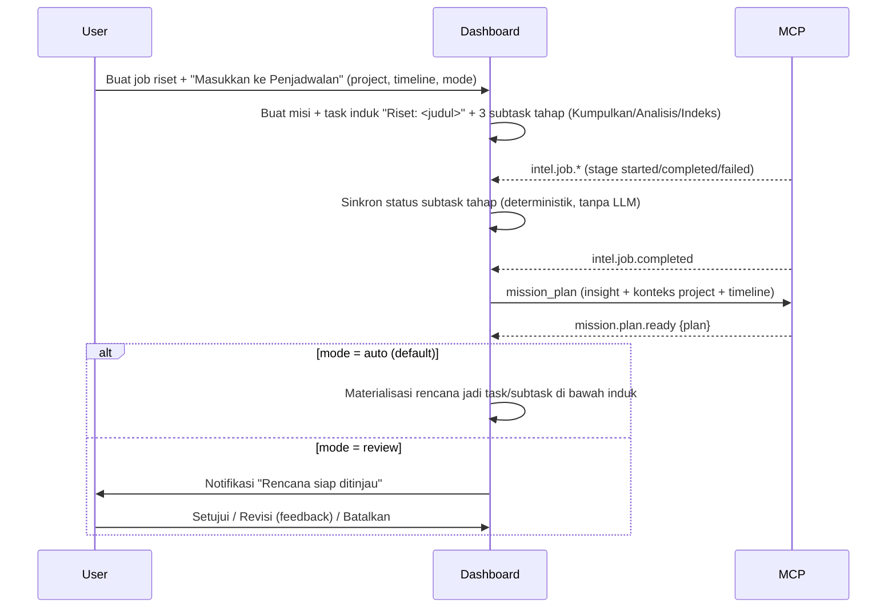

# Task: Agent Planner — Hasil Riset Otomatis Jadi Jadwal (P1)
**ID:** M3_TASK_013
**Status:** Belum dimulai (dokumen disusun 5 Nov 2026)
**Repo:** `mcp` + `marketingdashboardjtp`
**Dependencies:** M3_TASK_007 (pipeline `intel`), M3_TASK_008 (agent per tahap), Modul 2 (`mcp-api` Service API, toolset `task`, runtime agent)
**Estimasi:** 6 person-days
**Dipakai oleh:** [M3_TASK_014](M3_TASK_014_AGENT_MISSION.md) (Misi Agent) — mesin planner yang sama

## Objective
Job riset yang dibuat di halaman **Riset & Insight** otomatis muncul di **Penjadwalan** workspace aktif dan tetap sinkron selama berjalan. Setelah analisis selesai, agent menyusun **task tindak lanjut** (task + subtask bertanggal di dalam timeline pilihan user) berdasarkan insight. Agent sendiri yang menentukan mana task dan mana subtask.

Default **langsung jalan**: rencana langsung ditulis ke Penjadwalan. Opsi **tinjau dulu**: rencana tampil untuk disetujui, direvisi, atau dibatalkan.

## Konsep: "Misi" sebagai wadah
Satu entitas **misi** (`agent_missions`) menjadi wadah bersama untuk TASK_013 (sumber `intel_job`) dan TASK_014 (sumber `manual`).

```
Project (pilihan user)
└─ Task induk misi            depth 1, assignee = agent planner, rentang = timeline
   ├─ Task                    depth 2, hasil rencana agent
   │  └─ Subtask              depth 3 (MAX_TASK_DEPTH = 3)
   └─ ...
```

- **Batas wewenang:** semua tulisan agent berada di bawah **task induk misi**. Ini sudah ditegakkan MCP `_ensure_run_task`: run hanya boleh menulis di task run dan turunannya. Task milik manusia di luar induk hanya boleh diberi komentar.
- **Tanpa perubahan schema `tasks`:** keanggotaan task ditentukan oleh turunan `root_task_id`. Task buatan agent memakai `created_by_type = agent`.

## Alur


## Kontrak rencana (Zod ↔ Pydantic, kontrak 1.3)
```jsonc
{
  "summary": "≤ 600 karakter",
  "assumptions": ["≤ 10 butir"],
  "risks": [{ "code": "TIMELINE_TIGHT|LOW_DATA|...", "message": "..." }],
  "tasks": [                                  // 1–15 task
    {
      "ref": "t1",                            // unik dalam rencana
      "title": "≤ 200",
      "description": "≤ 2000 (markdown aman)",
      "start_date": "YYYY-MM-DD", "end_date": "YYYY-MM-DD",
      "priority": "none|low|medium|high|urgent",
      "tags": ["≤ 5"],
      "executor": "agent|human",              // dipakai TASK_014 fase eksekusi
      "agent_key": "strategist",              // opsional, wajib bila executor=agent
      "depends_on": ["ref lain"],
      "subtasks": [ /* 0–8, bentuk sama tanpa subtasks */ ]
    }
  ]
}
```

Validasi deterministik di MCP (sebelum event) dan diulang di Dashboard (sebelum materialisasi):
- **Total ukuran:** jumlah task + subtask ≤ 60.
- **Tanggal:** semua tanggal berada di dalam timeline. Rentang subtask berada di dalam rentang task induknya.
- **Dependensi:** `depends_on` tidak siklik dan menunjuk `ref` yang ada. Bila task mulai sebelum dependensinya selesai, beri risiko `TIMELINE_TIGHT`, bukan memadatkan jadwal diam-diam.
- **Output LLM tidak valid:** satu kali retry dengan pesan error. Bila gagal lagi, kirim `mission.plan.failed` dengan `PLAN_INVALID`.

## MCP
- [ ] Toolset `planner` (key Dashboard), tool `mission_plan(workspace_id, mission_id, agent_key, instruction, period, context, feedback?)`:
  - Bentuknya job async seperti `intel_job_create`; event dikirim lewat outbox per misi.
  - `context` berisi ringkasan insight job (TASK_005), daftar task yang sudah ada di project (judul + tanggal, maksimal 100), dan hasil `kb_search` workspace bila tersedia.
- [ ] Prompt planner dipilih berdasarkan profil agent:
  - Route `smart` memakai key Gateway agent (K5) dengan atribusi `X-Caller-Task: mission:<id>`.
  - Output terstruktur divalidasi `MissionPlan` (Pydantic).
- [ ] Event `mission.plan.ready {plan, cost}` dan `mission.plan.failed {code, message}`. Keduanya ditambahkan ke [M3_MCP_INTEGRATION.md](M3_MCP_INTEGRATION.md) sebagai kontrak 1.3.
- [ ] Estimasi biaya planning, dihitung dari heuristik token yang dipakai `intel_job_estimate`.

## Dashboard — backend
- [ ] **Migrasi:**
  - Tabel `agent_missions`:
    - Identitas dan relasi: `id`, `workspace_id`, `project_id`, `agent_id` (planner), `source` (`intel_job`|`manual`), `intel_job_id?`.
    - Isi misi: `title`, `instruction` (≤ 4000), `start_date`, `end_date`, `approval_mode` (`auto`|`review`, default `auto`).
    - Status: `status` (`planning`|`awaiting_review`|`scheduled`|`running`|`paused`|`completed`|`failed`|`cancelled`; `paused` dipakai TASK_014).
    - Hasil dan biaya: `plan` jsonb, `plan_revision`, `root_task_id`, `cost_usd`.
    - Audit: `created_by`, timestamps, `deleted_at`.
  - Tabel `mission_events` (log, idempoten per `event_id`).
- [ ] **Wizard job riset (`POST /workspaces/:ws/intel/jobs`):** field opsional `schedule: {project_id, start_date, end_date, approval_mode}`. Bila ada, dalam transaksi yang sama:
  - Buat misi.
  - Buat task induk "Riset: <judul>".
  - Buat 3 subtask tahap (Indeks hanya bila tahap index aktif).
- [ ] **Sinkron tahap:** di `IntelEventService`, event tahap memperbarui subtask:
  - `started` → `in_progress` + `agent_status=working`.
  - `completed` → `done`.
  - `failed` → tetap `in_progress` + `agent_status=failed` + komentar alasan.
  - `cancelled` → komentar.

  Realtime `TASK_UPDATED` dikirim seperti Modul 2.
- [ ] **Planning:**
  - Saat `intel.job.completed`, panggil `mission_plan`.
  - Saat `mission.plan.ready`:
    - Mode `auto` → materialisasi.
    - Mode `review` → status `awaiting_review` + notifikasi ke pembuat.
- [ ] **Materialisasi** dilakukan sekali saja. Kunci idempotensinya `(mission_id, plan_revision)`:
  - Buat task dan subtask lewat service task Modul 2 yang sama dengan `mcp-api`, sehingga activity log, realtime, dan aturan depth ikut berlaku.
  - Aktornya agent planner. Tag `misi` ditambahkan.
  - Dependensi ditulis sebagai baris "Bergantung pada: …" di deskripsi (belum ada relasi dependensi di Modul 2).
- [ ] **Endpoint:**
  - `GET /workspaces/:ws/missions` (viewer), `GET /missions/:id` (viewer; plan, status, biaya, event).
  - `POST /missions/:id/approve` (member).
  - `POST /missions/:id/revise {feedback ≤ 1000}`: re-plan, maksimal 3 revisi.
  - `POST /missions/:id/cancel`.
- [ ] **Ketahanan:**
  - Job riset dihapus → misi dibatalkan, task yang sudah dibuat tetap ada.
  - Project dihapus → misi `cancelled`.

## Dashboard — frontend
- [ ] **Wizard langkah 1:** bagian **Masukkan ke Penjadwalan** (default aktif bila workspace punya project):
  - Pilihan project (default: project terakhir dipakai).
  - Timeline tindak lanjut (default hari ini → +14 hari).
  - Mode: **Langsung jalan** (default) / **Tinjau dulu**.
- [ ] **Detail job:**
  - Kartu **Jadwal** berisi tautan ke task induk di Penjadwalan, status misi, dan jumlah task.
  - Bila `awaiting_review`: panel tinjauan berisi pohon task + tanggal + risiko, dengan tombol **Setujui** / **Revisi** / **Batalkan**.
- [ ] **Penjadwalan:** tidak perlu komponen baru. Task tampil sebagai task biasa dengan avatar agent dan tag `misi`.

## Acceptance Criteria
1. **Job dengan "Masukkan ke Penjadwalan":** task induk dan subtask tahap langsung muncul di Penjadwalan project terpilih. Statusnya berubah real-time mengikuti tahap job.
2. **Mode auto:** setelah job selesai, task tindak lanjut (≥ 1 task, subtask opsional) muncul di dalam timeline, tanpa aksi user.
3. **Mode review:** tidak ada task tindak lanjut sebelum **Setujui**. **Revisi** menghasilkan rencana baru, **Batalkan** tidak menulis apa pun.
4. **Rencana tidak valid** (tanggal di luar timeline, siklus, > 60 item) ditolak dengan `PLAN_INVALID`, tanpa tulisan parsial.
5. **Event ganda** (`mission.plan.ready` dikirim ulang) tidak menggandakan task.
6. **Biaya planning** tercatat per agent di konsol Gateway (`caller_task = mission:<id>`).
