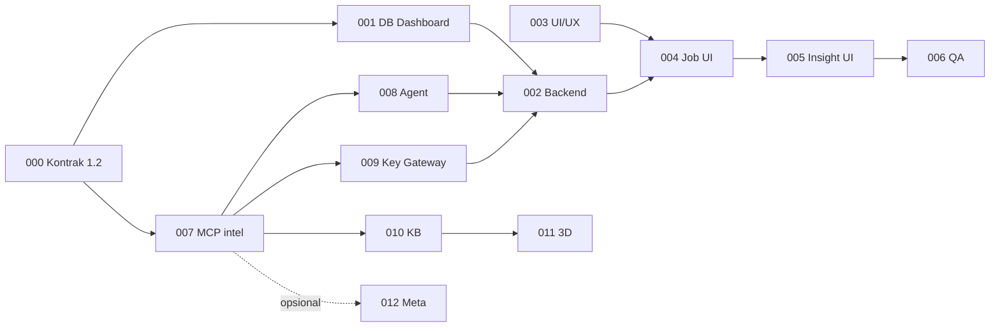

# Modul 3 — Data Scraping & Intelligence
## Index Dokumen, Urutan Kerja & Keputusan Teknis

> Dokumen ini adalah **pintu masuk** Modul 3. Baca ini dulu sebelum membuka dokumen task.
> Versi dokumen: **1.0** (4 November 2026). Disusun ulang dari draf awal mengikuti [M3_REVIEW.md](M3_REVIEW.md); draf awal disimpan di [`_arsip_draf/`](_arsip_draf/).

---

### 1. Ringkasan Modul
User Dashboard membuat **job riset** (keyword/URL + platform + rentang waktu), memilih **agent** untuk tiap tahap, melihat estimasi biaya, lalu menjalankannya. **MCP Marketing** (project `mcp`) mengumpulkan data (X, Threads, Web, Google Trends), menganalisis sentimen & tren, dan menyusun ringkasan — semua panggilan LLM-nya lewat **LLM Gateway** (project `llm-genai`) memakai **key Gateway milik agent** yang dipilih. Dashboard menampilkan status real-time, laporan insight, dan penjelajah data mentah.

**Objektif utama:** Dashboard ↔ MCP ↔ LLM Gateway terintegrasi end-to-end, dengan pemilihan agent dan sistem API key Gateway per agent.

### 2. Tiga Project yang Terlibat

| Project | Repo | Peran di Modul 3 | Port |
|---|---|---|---|
| `marketingdashboardjtp` | (repo ini) | UI, RBAC workspace, metadata job, ringkasan insight, penerima webhook | 3000 (API), 5173 (UI) |
| `mcp` | github.com/senavahni/mcp-custom-by-fr | Orchestrator job `intel`, collector, analisis, data mentah, profil agent, penyimpan key Gateway per agent | 4100 (`/mcp`) |
| `llm-genai` | github.com/senavahni/llm-genai | OpenAI-compatible gateway: project, key `lgw_...`, route `fast`/`smart`/`embed-default`, kuota, usage. Satu-satunya pemegang `OPENAI_API_KEY` | 8000 (`/v1`) |

Menjalankan ketiganya: `D:\Data.Fahrul\Documents\PortableDev\projects\start-project(dashboard-mcp-llmgateway).bat --no-runtime` (profil Gateway `remote-only`: `fast` → gpt-5-mini, `smart` → gpt-5, `embed-default` → text-embedding-3-small).

### 3. Peta Dokumen

| Dokumen | Isi | Repo pelaksana |
|---|---|---|
| [M3_PRD.md](M3_PRD.md) | Visi, tujuan, persona & RBAC, FR/NFR, di luar scope | — |
| [M3_USE_CASES.md](M3_USE_CASES.md) | UC-M3-01 … 08 dengan alur alternatif & error | — |
| [M3_MCP_INTEGRATION.md](M3_MCP_INTEGRATION.md) | **Kontrak 1.2**: toolset `intel`, event `intel.job.*`, key & atribusi Gateway, kode error | — |
| [M3_REVIEW.md](M3_REVIEW.md) | Hasil review draf awal & alasan perubahan | — |
| [M3_TASK_000](M3_TASK_000_CONTRACT.md) | Kontrak bersama: schema Zod ↔ Pydantic, fixture contract test | dashboard + mcp |
| [M3_TASK_001](M3_TASK_001_DB_SECURITY.md) | Tabel `intel_jobs`, `intel_job_stages`, `intel_insights`, keamanan | dashboard |
| [M3_TASK_002](M3_TASK_002_BACKEND_API.md) | REST API, klien MCP `intel`, webhook, Socket.IO, export | dashboard |
| [M3_TASK_003](M3_TASK_003_UI_UX.md) | Rancangan layar (wizard, daftar job, laporan, AI & Gateway) | dashboard |
| [M3_TASK_004](M3_TASK_004_FRONTEND_JOB_MGMT.md) | Frontend wizard & manajemen job | dashboard |
| [M3_TASK_005](M3_TASK_005_FRONTEND_INTELLIGENCE_UI.md) | Frontend laporan insight & raw data explorer | dashboard |
| [M3_TASK_006](M3_TASK_006_QA_DEPLOYMENT.md) | QA, contract test, E2E stack nyata, rilis | semua |
| [M3_TASK_007](M3_TASK_007_MCP_INTEL_TOOLSET.md) | Toolset `intel` di MCP: orchestrasi job induk/anak, event, klien Dashboard | **mcp** |
| [M3_TASK_008](M3_TASK_008_AGENT_SELECTION.md) | Pemilihan agent: kapabilitas, seed `Agent_Analyst`, picker | dashboard + mcp |
| [M3_TASK_009](M3_TASK_009_LLM_GATEWAY_KEYS.md) | Key Gateway per agent, atribusi, usage & halaman AI & Gateway | llm-genai + mcp + dashboard |
| [M3_TASK_010](M3_TASK_010_KNOWLEDGE_BASE.md) | Simpan hasil ke Knowledge Base (P1) | mcp + dashboard |
| [M3_TASK_011](M3_TASK_011_3D_VISUALIZATION.md) | Visualisasi 3D live (P2) | mcp + dashboard |
| [M3_TASK_012](M3_TASK_012_META_COLLECTOR.md) | Collector Meta (P2, di luar scope rilis pertama) | mcp |

### 4. Urutan Pengerjaan & Dependensi

**Pekerjaan di repo `mcp` (007, bagian MCP dari 008/009) harus selesai lebih dulu** — tanpa toolset `intel`, Dashboard tidak punya tool yang boleh dipanggil (key Dashboard saat ini hanya toolset `pm`).

| Fase | Task | Estimasi kasar |
|---|---|---|
| 1. Kontrak | 000 | 2 pd |
| 2. MCP & Gateway | 007, 008 (MCP), 009 (MCP + provisioning) | 8 pd |
| 3. Dashboard backend | 001, 002, 008/009 (Dashboard) | 7 pd |
| 4. Dashboard frontend | 003, 004, 005 | 8 pd |
| 5. QA | 006 | 3 pd |
| Lanjutan | 010 (P1), 011 & 012 (P2) | 3 + 6 + 5 pd |

### 5. Definition of Done
Sama dengan [Modul 1 README §5](../modul1/README.md#5-definition-of-done-berlaku-untuk-semua-task), ditambah:
1. Contract test (fixture bersama TASK_000) lulus di **kedua** repo (Jest di Dashboard, pytest di MCP).
2. Skenario UC-M3-01 s.d. 04 lulus di stack nyata (`start-project(...).bat --no-runtime`) dengan `OPENAI_API_KEY` sungguhan.
3. Tidak ada secret provider (OpenAI, X, Threads) maupun key `lgw_...` di repo Dashboard, DB Dashboard, atau respons API Dashboard.

### 6. Keputusan Teknis (disetujui 4 November 2026)

| # | Topik | Keputusan |
|---|---|---|
| K1 | Platform rilis pertama | **Web, X, Threads, Google Trends**. Meta → P2 ([TASK_012](M3_TASK_012_META_COLLECTOR.md)) |
| K2 | Orchestrator tahap | **MCP** (toolset `intel`, job induk + job anak). Dashboard hanya membuat job, menerima event, menampilkan |
| K3 | Gaya agent | **Pipeline deterministik + agent terpilih per tahap**: urutan tool tetap; agent menentukan route LLM, budget token, prompt sintesis, key Gateway, dan aktor tercatat. Agentic penuh → P2 |
| K4 | Data mentah | **Tetap di MCP** (`mcp.result_sets/result_items`); Dashboard membaca on-demand via `intel_items` |
| K5 | Key Gateway | **Satu key `lgw_...` per agent** (`researcher`, `analyst`, `strategist`) + key `system`, satu project Gateway `marketing-mcp`, disimpan terenkripsi di MCP; fallback `LLM_GATEWAY_API_KEY` |
| K6 | Pembuatan/rotasi key | P0 lewat skrip provisioning di MCP; tombol rotasi di Dashboard → P1 |
| K7 | Kredensial X/Threads/proxy | Tetap di MCP (`.env` + browser profile). Dashboard menampilkan status saja |
| K8 | Visualisasi 3D | Task terpisah P2; P0 memakai timeline tahap 2D |
| K9 | Desain | Implementasi langsung mengikuti pola Modul 2 (tanpa Figma) |
| K10 | Real-time | Socket.IO yang sudah ada (room workspace); polling hanya fallback |
| K11 | Retry | Membuat **job baru** (`retry_of_job_id`), job lama tidak diubah |

### 7. Status Implementasi
| Task | Status |
|---|---|
| 000 | ✅ Selesai — kontrak 1.2 + fixture bersama, contract test hijau di Dashboard (Jest) & MCP (pytest) |
| 007 | ✅ Selesai (repo mcp) — toolset `intel` 8 tool, job `intel_pipeline`, outbox per job, atribusi LLM per agent; migrasi `0003_intel` diterapkan ke DB |
| 001, 002 | Backend dikerjakan (commit `017b1e1`); migrasi `20261104000000_m3_intel` + seed diterapkan ke DB lokal |
| 008 | ✅ Selesai — wizard langkah 3 memakai default per tahap, diuji E2E-M3-01 |
| 009 | 🟡 Kode, provisioning, biaya per tahap di detail job & uji manual `/admin/requests` (`X-Caller-Agent`, `caller_task`) selesai (5 Nov 2026). Sisa: credential MCP `analyst` & `system` masih berisi admin key Gateway → ganti dengan `gateway-keys provision` (lihat TASK_009 §B); harga model gpt-5 di Gateway belum diisi (biaya Gateway $0); rotasi UI (P1) |
| 003 | ✅ Selesai — rancangan + state & arah visual (§B.8–B.9) |
| 004, 005 | ✅ Selesai — UI + Vitest + Playwright stack nyata `frontend/e2e/intel.stack.e2e.ts` (E2E-M3-01..07, sumber Web). Uji 5.000 item X menunggu profil browser X login (TASK_006 §C) |
| 006, 010 – 012 | Belum dimulai |
